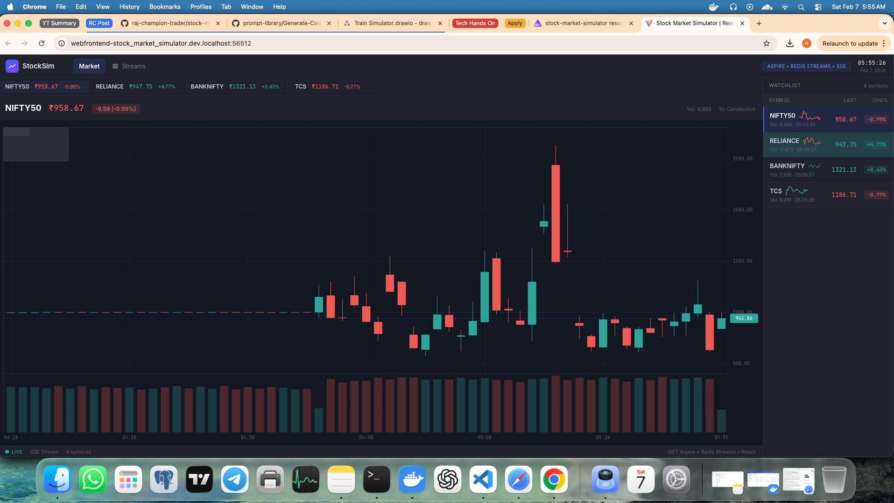
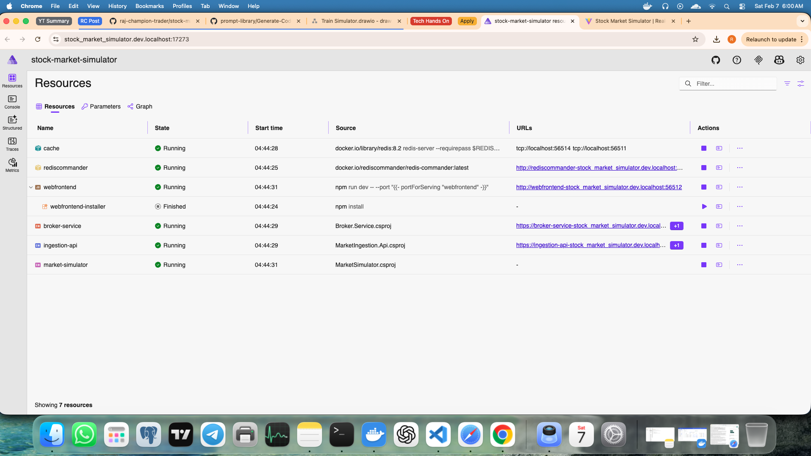
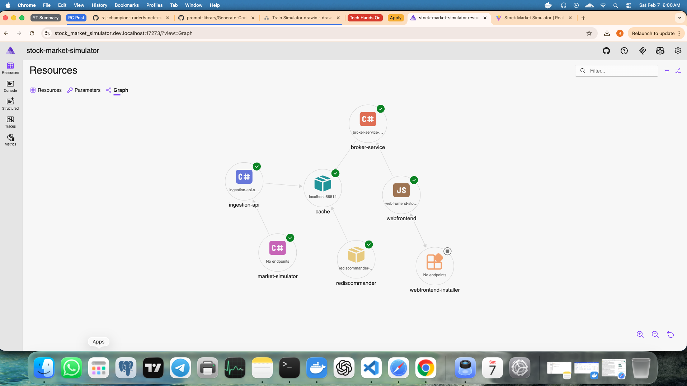

# Stock Market Simulator

A production-grade real-time streaming system that simulates financial market data using event-driven architecture. Built with .NET 10, Redis Streams, and React, this project demonstrates scalable patterns for high-frequency data distribution.



<details>
<summary><strong>More Screenshots</strong></summary>




</details>

### Data Flow


## Features

**Real-Time Data Pipeline**
- Sub-second tick-to-browser latency using Server-Sent Events (SSE)
- Redis Streams with consumer groups for horizontal scalability
- Event-driven architecture with bounded channels and backpressure handling

**Realistic Market Simulation**
- Geometric Brownian Motion with mean reversion (Ornstein-Uhlenbeck process)
- GARCH-inspired volatility clustering
- Configurable per-symbol price dynamics

**Professional UI**
- TradingView-inspired dark theme dashboard
- D3.js custom candlestick charts with interactive crosshair
- Live price updates, watchlist, and real-time OHLCV aggregation

**Production Patterns**
- OpenTelemetry distributed tracing across all services
- Health checks and observability endpoints
- Retry logic with exponential backoff
- SSE reconnection with `Last-Event-ID` replay support
- Bounded channels with backpressure (`DropOldest` policy)
- Non-blocking fan-out via `TickBroadcaster`

## Architecture

```
Market Simulator → Ingestion API → Redis Streams → Broker Service → SSE → React Frontend
                     (HTTP)          (Pub/Sub)       (Consumer)    (Push)   (EventSource)
```

The system consists of five services orchestrated by .NET Aspire:

| Service | Technology | Purpose |
|---|---|---|
| **Market Simulator** | .NET Worker | Generates realistic price ticks using quantitative finance models |
| **Ingestion API** | ASP.NET Minimal API | Validates and publishes market data to Redis Streams |
| **Broker Service** | ASP.NET Web API | Consumes from Redis, aggregates candles, streams via SSE |
| **Web Frontend** | React + TypeScript | Real-time trading dashboard with D3 charts |
| **Redis** | Redis 7+ | Message broker with stream support |

## Quick Start

### Prerequisites
- .NET 10.0.102+ SDK
- Docker Desktop
- Node.js 18+ (for frontend)

### Run All Services

```bash
# Run all services with Aspire
cd src/stock-market-simulator.AppHost
dotnet run
```

Aspire provisions Redis automatically. Ensure Docker Desktop is running.

The system will start in sequence:
1. Redis (port 6379)
2. Market Ingestion API (port 5001)
3. Broker Service (port 5002)  
4. Market Simulator (background)
5. Web Frontend (port 5173)

Open your browser to http://localhost:5173

### Verify It Works

You should see:
- 4 stock symbols (NIFTY50, BANKNIFTY, RELIANCE, TCS) in the ticker strip
- Prices updating every ~300ms with green/red flashes
- Candlestick chart building in real-time
- "LIVE" status indicator in the bottom bar

## Technology Stack

**Backend**
- .NET 10 with C# 13
- ASP.NET Core (Minimal APIs + Controllers)
- Redis Streams (StackExchange.Redis)
- .NET Aspire 13.1 orchestration
- OpenTelemetry with OTLP export

**Frontend**
- React 19 with TypeScript 5.9
- D3.js 7 for charts
- Material UI 7 components
- Vite 7 build tool
- EventSource API for SSE

## Documentation

📘 **[Complete Reference Documentation](reference-docs/README.md)** — Start here for comprehensive technical documentation

| Document | Description |
|---|---|
| [High-Level Design](reference-docs/01-HIGH-LEVEL-DESIGN.md) | System overview, component inventory, deployment topology |
| [Low-Level Design](reference-docs/02-LOW-LEVEL-DESIGN.md) | Detailed service design, class diagrams, sequences |
| [Architecture Decisions](reference-docs/03-ARCHITECTURE-DECISION-RECORDS.md) | 10 ADRs explaining key design choices |
| [C4 Diagrams](reference-docs/04-C4-DIAGRAMS.md) | Visual architecture with 20+ Mermaid diagrams |
| [Functional Guide](reference-docs/05-FUNCTIONAL-TECHNICAL-DOCUMENTATION.md) | Plain-English walkthrough for non-technical audiences |

## Project Structure

```
src/
├── stock-market-simulator.AppHost/    # Aspire orchestration
├── Shared.Contracts/                   # Data models (records)
├── MarketSimulator/                    # Price generation engine
├── MarketIngestion.Api/                # HTTP ingestion endpoint
├── Broker.Service/                     # Redis consumer + SSE server
│   ├── Controllers/                    # SSE and monitoring endpoints
│   └── Services/                       # Aggregation and history
└── frontend/                           # React/TypeScript dashboard
    ├── src/components/                 # Chart, cards, navigation
    ├── src/hooks/                      # useMarketData (SSE client)
    └── src/pages/                      # Dashboard, Redis monitoring
```

## Configuration

### Market Simulator

Edit `src/MarketSimulator/appsettings.json`:

```json
{
  "Symbols": ["NIFTY50", "BANKNIFTY", "RELIANCE", "TCS"],
  "TickIntervalMs": 300,
  "InitialPrice": 1000
}
```

### Broker Service

Edit `src/Broker.Service/appsettings.json`:

```json
{
  "Candlestick": {
    "IntervalSeconds": 60,
    "EmitThrottleMs": 500,
    "MaxHistory": 60
  }
}
```

## Key Design Patterns

**Bounded Channels with Backpressure**  
Uses `BoundedChannelFullMode.DropOldest` to prevent memory exhaustion. The system intentionally drops stale ticks rather than blocking producers — in financial streaming, a late price is worse than a missing one.

**Fan-Out with TickBroadcaster**  
Single Redis consumer broadcasts to multiple bounded channels (SSE + Aggregator) using non-blocking `TryWrite`. Logged warnings on drops provide visibility without impacting throughput.

**SSE with Last-Event-ID Replay**  
`MarketEventBuffer` implements a lock-guarded circular buffer with monotonic event IDs. On reconnection, the `stream-with-replay` endpoint reads the `Last-Event-ID` header and replays missed events — preventing data gaps that would break chart continuity.

**Dual-Channel SSE Multiplexing**  
The SSE controller multiplexes tick and candlestick channels into a single event stream using `Task.WhenAny` on `WaitToReadAsync`, avoiding busy-wait polling while delivering both data types over one connection.

**Backend Candlestick Aggregation**  
OHLCV candles are computed server-side to maintain a single source of truth. Throttled emission (500ms) prevents overwhelming clients while maintaining visual smoothness.

**Realistic Price Generation**  
Combines Geometric Brownian Motion, Ornstein-Uhlenbeck mean reversion, and GARCH-inspired volatility clustering to produce chart patterns that are statistically indistinguishable from real market data.

## Observability

**Health Checks**
- Ingestion API: http://localhost:5001/health
- Broker Service: http://localhost:5002/health

**Redis Monitoring**
- Web UI: http://localhost:5173/redis-monitoring
- Shows stream message count, consumer groups, pending messages

**Distributed Tracing**
- OpenTelemetry instrumentation on all .NET services
- Console export enabled by default
- OTLP export configured (connect to Jaeger/Tempo/Azure Monitor)

## Troubleshooting

| Issue | Solution |
|---|---|
| Dashboard shows "Connecting..." | Verify Broker Service is running on port 5002 |
| Chart is empty | Wait 60 seconds for first candle to complete |
| Prices not updating | Check Market Simulator is running and posting to Ingestion API |
| Redis connection errors | Ensure Redis container is running: `docker ps` |

For detailed troubleshooting, see the [Functional Documentation](reference-docs/05-FUNCTIONAL-TECHNICAL-DOCUMENTATION.md#9-monitoring-and-diagnostics).

## Building

```bash
cd src
dotnet build
```

All services target .NET 10.0. Frontend requires `npm install` in `src/frontend/`.

## Testing

```bash
# Start dependencies
docker run -d --name test-redis -p 6379:6379 redis:latest

# Run tests
cd tests
dotnet test
```

## Why This Stack?

**Redis Streams over Kafka** — Simpler operational model with built-in consumer groups and message persistence. No ZooKeeper dependency. Suitable for single-DC workloads where sub-millisecond latency matters more than cross-region replication.

**SSE over WebSockets** — Market data is inherently unidirectional (server → client). SSE provides automatic reconnection via the `EventSource` API, `Last-Event-ID` replay semantics, and works through standard HTTP infrastructure without upgrade negotiation. For bidirectional needs (order placement, chat), WebSockets or SignalR would be the right choice.

**SSE over SignalR** — SignalR abstracts away connection management, authentication, and user targeting — but that abstraction has a cost. This project deliberately implements SSE at a lower level to demonstrate the underlying patterns: bounded channel management, event replay buffers, and backpressure handling. Understanding these primitives matters when debugging production streaming issues, regardless of the transport layer.

**.NET Aspire** — Service discovery, health checks, dependency ordering, and connection string injection without Docker Compose YAML complexity. Aspire provisions Redis automatically and wires inter-service URLs via environment variables.

**Backend Aggregation** — Candlestick computation happens server-side to maintain a single source of truth. This eliminates clock-sync issues across clients and reduces frontend CPU usage — the browser renders pre-computed OHLCV bars rather than aggregating raw ticks.

See [Architecture Decision Records](reference-docs/03-ARCHITECTURE-DECISION-RECORDS.md) for detailed rationale.

## Production Considerations

This project implements a **broadcast streaming model** — all connected clients receive the same market data feed. This is architecturally appropriate for market data (public price information is not user-specific), but real-world systems often require additional capabilities.

Below are the production patterns this project demonstrates, and the extension points for scenarios that require them:

### What's Implemented

| Concern | Implementation |
|---|---|
| **Reconnection** | `EventSource` auto-reconnect + custom retry with max attempts |
| **Event Replay** | `MarketEventBuffer` ring buffer with `Last-Event-ID` header support |
| **Backpressure** | Bounded channels with `DropOldest` — producers never block |
| **Fan-Out** | `TickBroadcaster` distributes to multiple consumers via non-blocking `TryWrite` |
| **Heartbeat** | 15-second keep-alive prevents proxy/load-balancer timeouts |
| **Proxy Compatibility** | `X-Accel-Buffering: no` header for nginx; `Cache-Control: no-cache` for CDNs |

### Extension Points for Authenticated / Multi-Tenant Scenarios

| Concern | Recommended Approach |
|---|---|
| **Authentication** | The `EventSource` API doesn't support custom headers. Use **cookie-based auth** (sent automatically) or a **short-lived token** flow: exchange a JWT for a 30-second token via a login endpoint, pass it as a query parameter to the SSE endpoint. Store tokens in Redis with TTL to minimize the attack surface. |
| **User Targeting** | Implement a `ConnectionManager` backed by `ConcurrentDictionary<UserId, Channel<T>>` — conceptually similar to SignalR's `IHubContext`. Producers write to user-specific channels; SSE endpoints read from the user's channel exclusively. |
| **Reverse Proxy** | SSE works through YARP, nginx, and most reverse proxies out of the box. Key settings: disable response buffering (`proxy_buffering off` in nginx), set generous timeouts for long-lived connections, and handle token refresh on the client side before the session expires. |

The current broadcast architecture can evolve to per-user streaming by introducing a connection manager layer without changing the underlying channel and backpressure mechanics.

## License

MIT License - see [LICENSE](LICENSE) for details.

---

## About

This project exists because I wanted to understand SSE, Redis Streams, and real-time data pipelines at a level deeper than tutorials typically cover. Instead of a toy demo, I built a system complex enough to encounter real production concerns — backpressure, reconnection, event replay, and data aggregation.

The result is a working financial data simulator that demonstrates:
- How bounded channels prevent memory exhaustion in high-throughput streaming
- Why `Last-Event-ID` replay matters for chart continuity after disconnects
- How to multiplex multiple data types over a single SSE connection
- What realistic price simulation looks like using quantitative finance models
- How .NET Aspire simplifies multi-service orchestration

I've documented the architectural decisions, trade-offs, and extension points so others can learn from (and build on) this work.

---

## Acknowledgments

Documentation and architectural refinement assisted by [GitHub Copilot](https://github.com/features/copilot).

Special thanks to [Milan Jovanović Tech](https://www.youtube.com/@MilanJovanovicTech/) for sharing valuable content and keeping the community alive.
