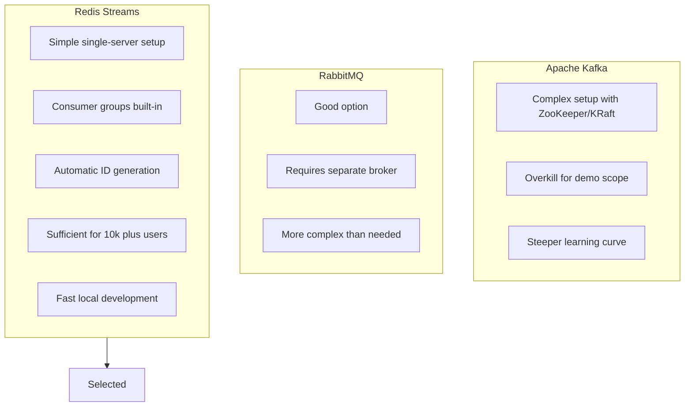

# ADR-001: Use Redis Streams for Event Distribution

**Status:** Accepted  
**Date:** January 2026  
**Deciders:** Development Team

---

## Context

The Stock Market Simulator requires a message broker to distribute market data events from the ingestion service to multiple broker service instances. Key requirements include:

- Real-time message delivery with low latency
- Consumer group support for horizontal scaling
- Message persistence for reliability
- Simple setup for local development
- Support for at-least-once delivery semantics

### Options Considered

1. **Apache Kafka**: Industry-standard for high-throughput event streaming
2. **RabbitMQ**: Enterprise message broker with AMQP protocol
3. **Redis Streams**: Redis-native streaming data structure
4. **In-memory channels**: .NET Channel<T> without persistence

---

## Decision

We will use **Redis Streams** as the event distribution backbone.

---

## Rationale

### Why Redis Streams?



### Comparison Matrix

| Criteria | Redis Streams | Kafka | RabbitMQ |
|----------|--------------|-------|----------|
| Setup Complexity | Low | High | Medium |
| Learning Curve | Low | High | Medium |
| Consumer Groups | Yes | Yes | Yes |
| Persistence | Yes | Yes | Yes |
| Throughput | 100k+ msg/s | 1M+ msg/s | 100k+ msg/s |
| Fits Demo Scope | Excellent | Overkill | Good |

### Key Features Used

1. **XADD**: Append messages to stream with auto-generated IDs
2. **XREADGROUP**: Consumer group pattern for reliable consumption
3. **XACK**: Acknowledge processed messages
4. **MAXLEN**: Automatic stream trimming for bounded memory

---

## Consequences

### Positive

- **Simple deployment**: Single Redis container handles caching and streaming
- **Fast development**: No complex broker setup required
- **Good enough scale**: Handles 10k+ concurrent users easily
- **Built-in persistence**: Messages survive broker restarts
- **Consumer groups**: Enables horizontal scaling of broker services

### Negative

- **Single point of failure**: Redis becomes critical infrastructure
- **Limited replay**: No infinite retention like Kafka
- **Less tooling**: Fewer monitoring and management tools than Kafka
- **Memory bound**: Stream size limited by Redis memory

### Mitigations

- **Reliability**: Use Redis persistence (RDB/AOF) in production
- **Scaling**: Redis Cluster for horizontal scaling if needed
- **Monitoring**: Use Redis Commander or RedisInsight for visibility

---

## Implementation

### Publishing (Ingestion API)

```csharp
await db.StreamAddAsync(
    "marketdata:stream",
    "data",
    json,
    maxLength: 10000,
    useApproximateMaxLength: true);
```

### Consuming (Broker Service)

```csharp
var result = await db.StreamReadGroupAsync(
    StreamKey,
    ConsumerGroup,
    ConsumerName,
    ">",
    count: 10);
```

---

## References

- [Redis Streams Documentation](https://redis.io/docs/data-types/streams/)
- [Consumer Groups Tutorial](https://redis.io/docs/data-types/streams-tutorial/)
- [StackExchange.Redis Streams](https://stackexchange.github.io/StackExchange.Redis/Streams)
