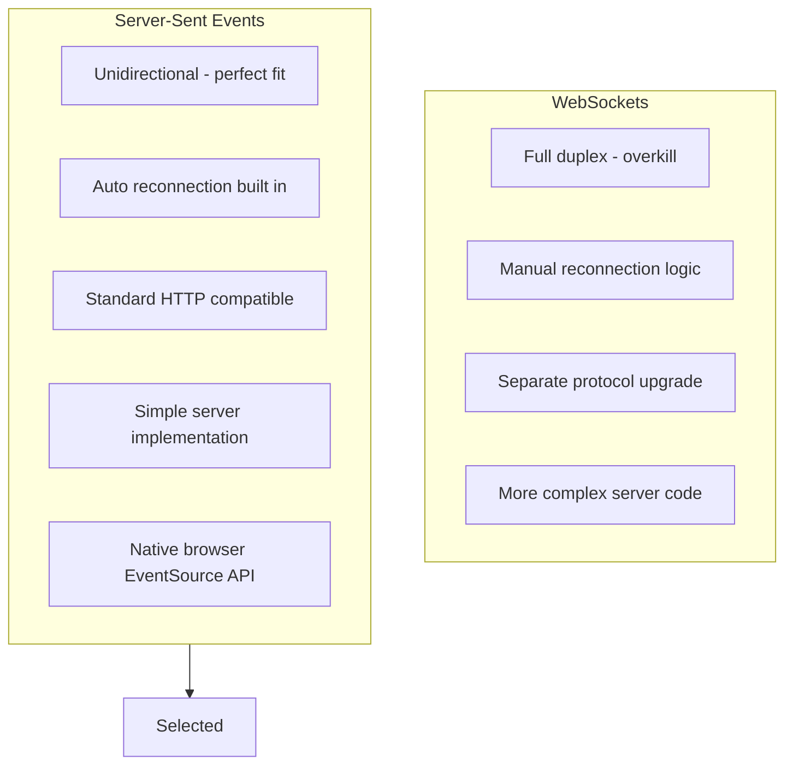

# ADR-002: Use Server-Sent Events for Client Push

**Status:** Accepted  
**Date:** January 2026  
**Deciders:** Development Team

---

## Context

The Stock Market Simulator needs to push real-time price updates to web browser clients. The communication pattern is:

- **Direction**: Server to client (one-way push)
- **Frequency**: Multiple updates per second per symbol
- **Clients**: Standard web browsers
- **Requirements**: Auto-reconnection, minimal overhead

### Options Considered

1. **WebSockets**: Full-duplex communication protocol
2. **Server-Sent Events (SSE)**: HTTP-based unidirectional push
3. **Long Polling**: HTTP request held open until data available
4. **gRPC Streaming**: HTTP/2 based streaming

---

## Decision

We will use **Server-Sent Events (SSE)** for pushing market data to browser clients.

---

## Rationale

### Why SSE over WebSockets?



### Comparison Matrix

| Criteria | SSE | WebSockets | Long Polling |
|----------|-----|------------|--------------|
| Direction | Server to client | Bidirectional | Server to client |
| Protocol | HTTP | WS | HTTP |
| Auto-reconnect | Built-in | Manual | Manual |
| Browser Support | All modern | All modern | All |
| Proxy Friendly | Yes | Sometimes | Yes |
| Implementation | Simple | Medium | Simple |

### Use Case Fit

Our use case is **one-way server push**:
- Server sends price updates
- Client only displays data
- No client-to-server data needed

SSE is designed exactly for this pattern.

---

## Consequences

### Positive

- **Native browser support**: EventSource API with automatic reconnection
- **HTTP compatible**: Works through corporate proxies and firewalls
- **Simple implementation**: Just write text to response stream
- **Event types**: Named events (marketdata, heartbeat, connected)
- **Automatic reconnection**: Browser handles reconnects with Last-Event-ID

### Negative

- **One-way only**: Cannot send data from client to server
- **Text-based**: Cannot send binary data directly
- **Connection limit**: Browsers limit concurrent SSE connections (6 per domain)
- **No built-in presence**: Cannot easily detect client disconnection

### Mitigations

- **Bidirectional needs**: Use separate HTTP POST if client needs to send data
- **Connection limits**: Sufficient for demo; production could use connection pooling
- **Presence detection**: Heartbeat mechanism detects stale connections

---

## Implementation

### Server Side (ASP.NET Core)

```csharp
[HttpGet("stream")]
public async Task Stream(CancellationToken cancellationToken)
{
    Response.Headers.Append("Content-Type", "text/event-stream");
    Response.Headers.Append("Cache-Control", "no-cache");
    Response.Headers.Append("Connection", "keep-alive");

    await WriteEvent("connected", new { clientId = Guid.NewGuid() }, cancellationToken);
    
    await foreach (var data in channel.Reader.ReadAllAsync(cancellationToken))
    {
        await WriteEvent("marketdata", data, cancellationToken);
    }
}

private async Task WriteEvent(string eventName, object data, CancellationToken ct)
{
    var json = JsonSerializer.Serialize(data);
    await Response.WriteAsync($"event: {eventName}\n", ct);
    await Response.WriteAsync($"data: {json}\n\n", ct);
    await Response.Body.FlushAsync(ct);
}
```

### Client Side (React/TypeScript)

```typescript
const eventSource = new EventSource('/api/marketdata/stream');

eventSource.addEventListener('marketdata', (e) => {
    const data = JSON.parse(e.data);
    updatePrice(data);
});

eventSource.onerror = () => {
    // Browser automatically attempts reconnection
    console.log('Connection lost, reconnecting...');
};
```

---

## SSE Protocol Format

```
event: marketdata
data: {"symbol":"NIFTY50","price":1000.50}

event: heartbeat
data: {"timestamp":"2026-01-22T10:30:00Z"}

```

**Key Elements**:
- Lines prefixed with `event:` specify event type
- Lines prefixed with `data:` contain payload
- Double newline terminates each message

---

## References

- [MDN Server-Sent Events](https://developer.mozilla.org/en-US/docs/Web/API/Server-sent_events)
- [EventSource API](https://developer.mozilla.org/en-US/docs/Web/API/EventSource)
- [SSE vs WebSockets](https://ably.com/topic/sse-vs-websockets)
