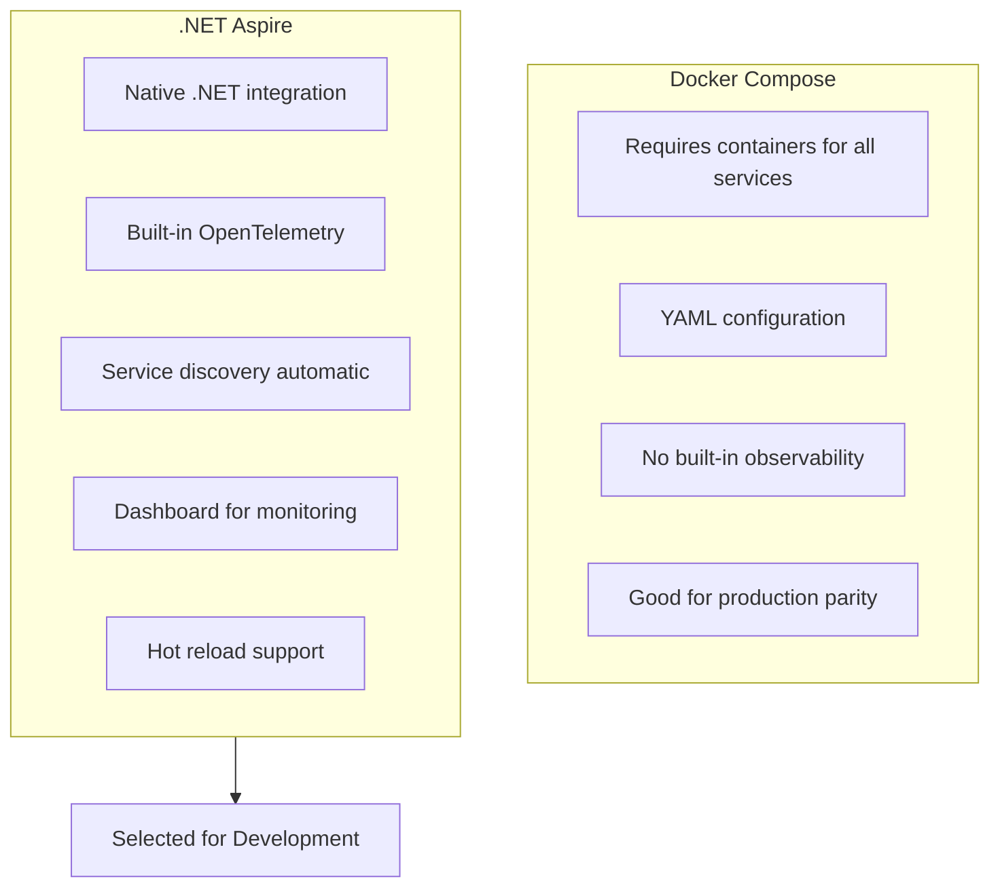
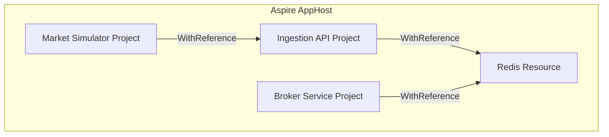

# ADR-003: Use .NET Aspire for Orchestration

**Status:** Accepted  
**Date:** January 2026  
**Deciders:** Development Team

---

## Context

The Stock Market Simulator consists of multiple services that need to be started, configured, and monitored together:

- Market Simulator (background worker)
- Market Ingestion API
- Broker Service
- Redis
- Web Application

### Requirements

- Simple local development experience
- Service discovery for inter-service communication
- Observability (logging, tracing, metrics)
- Configuration management
- Health monitoring

### Options Considered

1. **Docker Compose**: Container orchestration via YAML
2. **.NET Aspire**: Cloud-native .NET orchestration
3. **Manual scripts**: Shell scripts to start services
4. **Kubernetes**: Container orchestration platform

---

## Decision

We will use **.NET Aspire** for service orchestration during development.

---

## Rationale

### Why .NET Aspire?



### Comparison Matrix

| Criteria | .NET Aspire | Docker Compose | Manual Scripts |
|----------|-------------|----------------|----------------|
| .NET Integration | Native | Separate | None |
| Service Discovery | Automatic | Manual | Manual |
| Observability | Built-in | Add-on | None |
| Learning Curve | Low for .NET devs | Medium | Low |
| Hot Reload | Yes | No | Yes |
| Production Ready | Limited | Yes | No |

### Key Features

1. **AppHost Project**: Central orchestration entry point
2. **Service References**: Automatic dependency injection
3. **Built-in Dashboard**: Traces, logs, metrics in one place
4. **Resource Management**: Redis, databases auto-configured

---

## Consequences

### Positive

- **Streamlined development**: Single `dotnet run` starts everything
- **Automatic service discovery**: Services find each other by name
- **Built-in observability**: OpenTelemetry traces without configuration
- **Type-safe configuration**: C# instead of YAML
- **Health monitoring**: Dashboard shows service status

### Negative

- **Aspire Dashboard issues**: DCP limitations with .NET 10 preview
- **Production limitations**: Not designed for production deployment
- **Learning curve**: New concept for developers unfamiliar with Aspire
- **Version compatibility**: Aspire 9.5.2 requires specific .NET versions

### Mitigations

- **Production**: Use Docker Compose or Kubernetes for production
- **Fallback**: Provided `run-services.sh` script for manual startup
- **Documentation**: Clear instructions for both approaches

---

## Implementation

### AppHost Program.cs

```csharp
var builder = DistributedApplication.CreateBuilder(args);

// Add Redis
var redis = builder.AddRedis("redis")
    .WithDataVolume()
    .WithRedisCommander();

// Add Market Ingestion API
var ingestion = builder.AddProject("ingestion-api", "../MarketIngestion.Api")
    .WithReference(redis)
    .WithHttpEndpoint(port: 5001, name: "ingestion-http");

// Add Broker Service
var broker = builder.AddProject("broker-service", "../Broker.Service")
    .WithReference(redis)
    .WithHttpEndpoint(port: 5002, name: "broker-http");

// Add Market Simulator
builder.AddProject("market-simulator", "../MarketSimulator")
    .WithReference(ingestion)
    .WithEnvironment("IngestionApiUrl", ingestion.GetEndpoint("ingestion-http"));

builder.Build().Run();
```

### Service Reference Pattern



---

## Alternative: Manual Startup

When Aspire Dashboard is unavailable, use the provided script:

```bash
./run-services.sh
```

This script:
1. Starts Redis in Docker
2. Builds all .NET projects
3. Provides instructions for starting each service

---

## References

- [.NET Aspire Documentation](https://learn.microsoft.com/en-us/dotnet/aspire/)
- [Aspire Service Discovery](https://learn.microsoft.com/en-us/dotnet/aspire/service-discovery/overview)
- [Aspire Dashboard](https://learn.microsoft.com/en-us/dotnet/aspire/fundamentals/dashboard)
