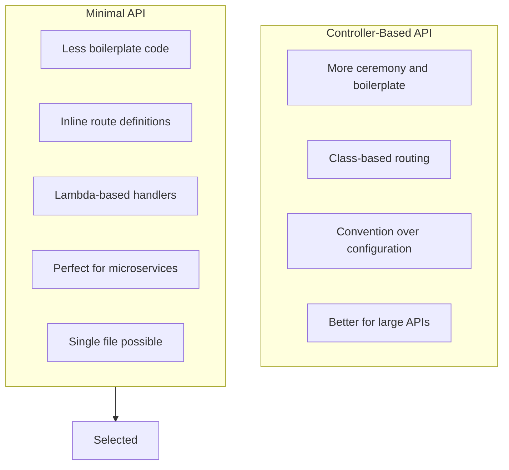
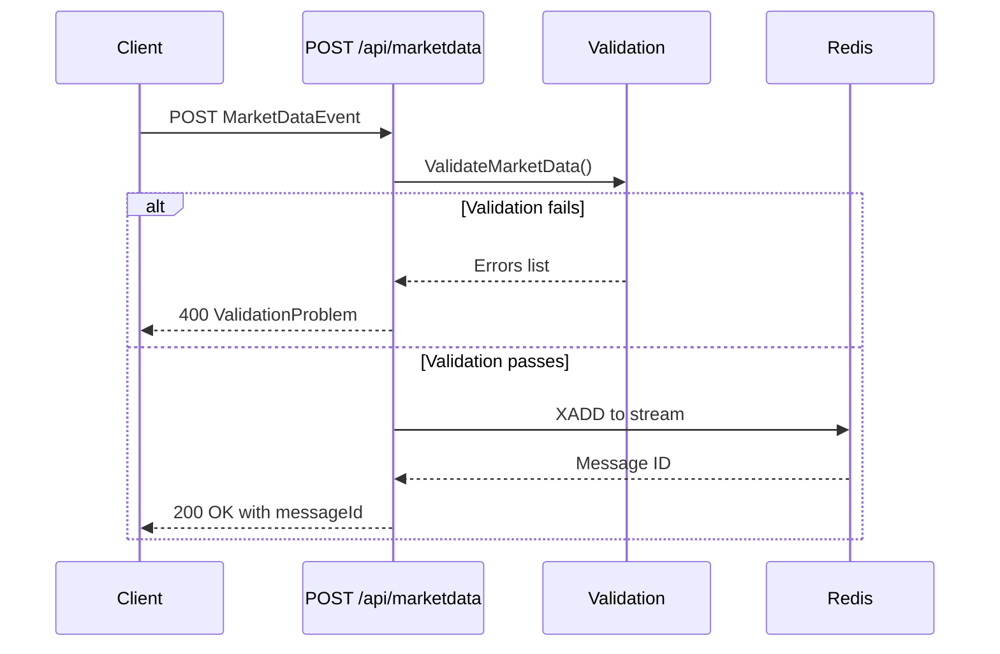

# ADR-004: Use Minimal API for Ingestion Service

**Status:** Accepted  
**Date:** January 2026  
**Deciders:** Development Team

---

## Context

The Market Ingestion API has a simple requirement:

- Single POST endpoint to receive market data
- Validate incoming data
- Publish to Redis Streams
- Return success/failure response

### Options Considered

1. **Minimal API**: Streamlined ASP.NET Core API approach
2. **Controller-based API**: Traditional MVC controller pattern
3. **gRPC**: Protocol Buffers-based RPC framework

---

## Decision

We will use **Minimal API** for the Market Ingestion Service.

---

## Rationale

### Why Minimal API?



### Comparison

| Criteria | Minimal API | Controller-Based |
|----------|-------------|------------------|
| Boilerplate | Minimal | More |
| File Count | 1 (Program.cs) | 2+ (Controller + Program) |
| Startup Time | Faster | Slightly slower |
| Flexibility | High | High |
| Testability | Good | Good |
| Fit for 1 endpoint | Excellent | Overkill |

---

## Consequences

### Positive

- **Concise code**: Entire API in single Program.cs file
- **Clear flow**: Request handling visible at a glance
- **Fast startup**: Less reflection and discovery overhead
- **Modern .NET**: Follows latest ASP.NET Core patterns
- **Easy testing**: Route handlers are just lambdas

### Negative

- **Scaling concerns**: May need refactoring for many endpoints
- **Less structure**: No enforced organization pattern
- **Action filters**: Different syntax than controller-based

### Mitigations

- **Future refactoring**: Can extract to controllers if API grows
- **Organization**: Group related routes with MapGroup()

---

## Implementation

### Complete API (Program.cs)

```csharp
var builder = WebApplication.CreateBuilder(args);

builder.Services.AddSingleton<IConnectionMultiplexer>(
    ConnectionMultiplexer.Connect("localhost:6379"));
builder.Services.AddHealthChecks()
    .AddRedis("localhost:6379");

var app = builder.Build();

app.MapHealthChecks("/health");

app.MapPost("/api/marketdata", async (
    [FromBody] MarketDataEvent marketData,
    IConnectionMultiplexer redis,
    ILogger<Program> logger) =>
{
    var errors = ValidateMarketData(marketData);
    if (errors.Count > 0)
        return Results.ValidationProblem(errors.ToDictionary(e => e, e => new[] { e }));

    var db = redis.GetDatabase();
    var json = JsonSerializer.Serialize(marketData);
    var messageId = await db.StreamAddAsync(
        "marketdata:stream", "data", json,
        maxLength: 10000, useApproximateMaxLength: true);

    return Results.Ok(new { messageId = messageId.ToString() });
});

app.Run();
```

### Request Flow



---

## Endpoint Specification

| Aspect | Value |
|--------|-------|
| Path | /api/marketdata |
| Method | POST |
| Request Body | MarketDataEvent JSON |
| Success Response | 200 { messageId: string } |
| Validation Error | 400 ValidationProblem |
| Redis Error | 503 Problem |

---

## References

- [Minimal APIs Overview](https://learn.microsoft.com/en-us/aspnet/core/fundamentals/minimal-apis)
- [Minimal APIs vs Controllers](https://learn.microsoft.com/en-us/aspnet/core/fundamentals/minimal-apis/overview)
