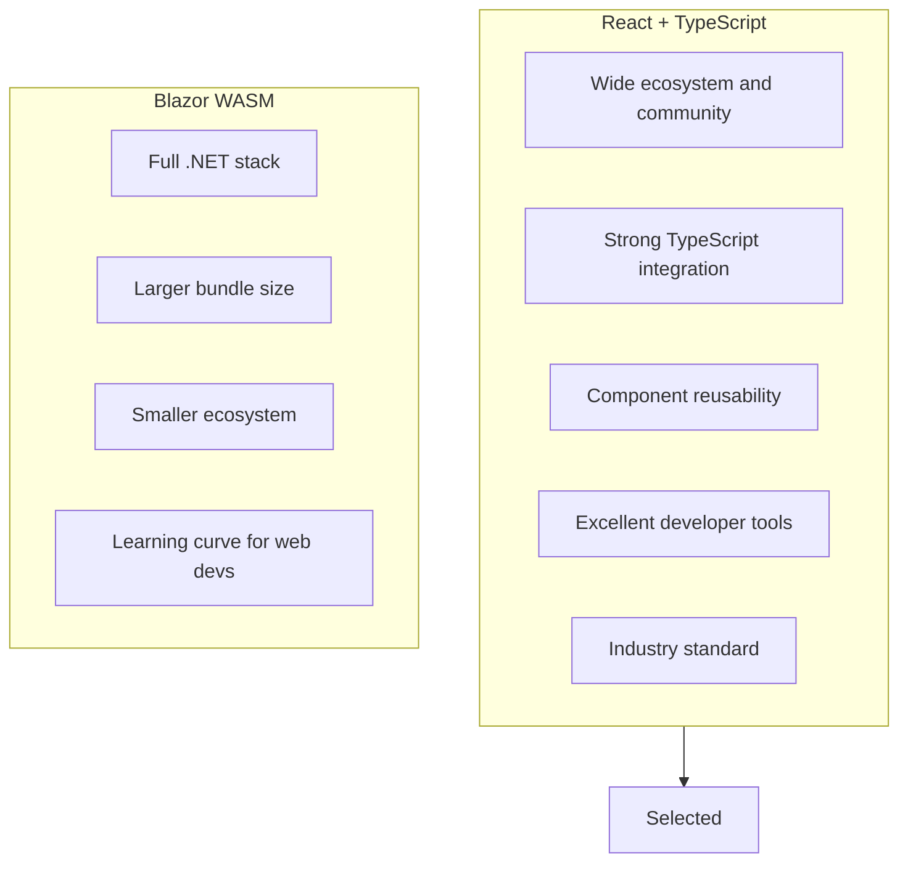
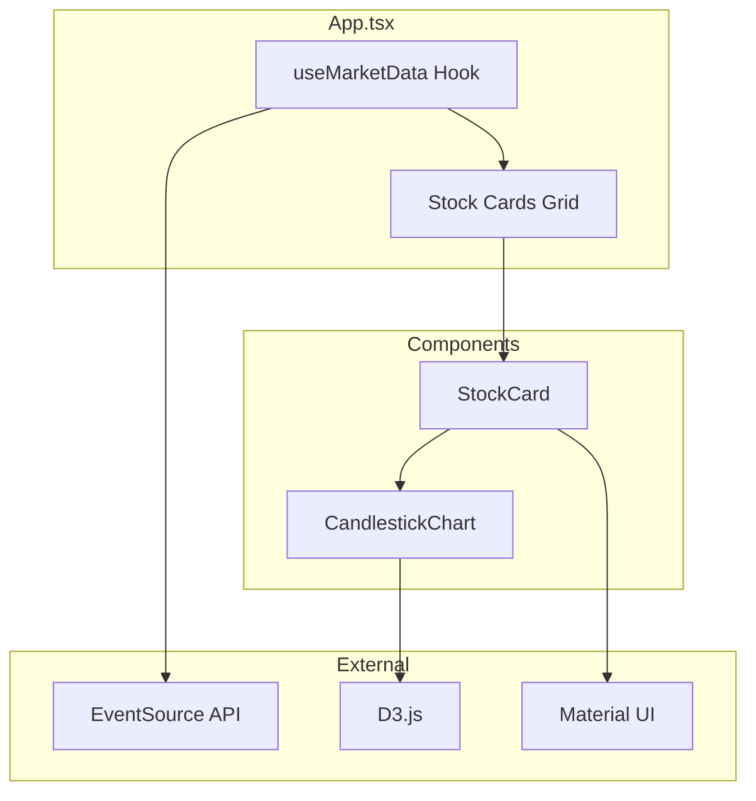

# ADR-005: Use React with TypeScript for Frontend

**Status:** Accepted  
**Date:** January 2026  
**Deciders:** Development Team

---

## Context

The Stock Market Simulator needs a web frontend to display real-time stock prices with:

- Live updating price cards
- Candlestick chart visualization
- Connection status indicators
- Professional appearance

### Options Considered

1. **React + TypeScript**: Component-based UI with type safety
2. **Vue.js**: Progressive framework with reactivity
3. **Blazor WebAssembly**: .NET in the browser
4. **Vanilla JavaScript**: No framework overhead

---

## Decision

We will use **React with TypeScript** for the web frontend, along with **Material UI** for components and **D3.js** for charting.

---

## Rationale

### Why React + TypeScript?



### Technology Stack

| Component | Technology | Purpose |
|-----------|-----------|---------|
| UI Framework | React 19+ | Component model |
| Type Safety | TypeScript 5+ | Compile-time checks |
| Components | Material UI 7+ | Professional UI |
| Charts | D3.js 7+ | Candlestick visualization |
| Build Tool | Vite | Fast development builds |
| State | React Hooks | Local state management |

### Comparison

| Criteria | React + TS | Vue.js | Blazor WASM |
|----------|-----------|--------|-------------|
| Ecosystem | Largest | Large | Growing |
| TypeScript | Excellent | Good | N/A (.NET) |
| Bundle Size | Medium | Small | Large |
| Learning Curve | Medium | Low | Medium |
| Charting Libraries | Many | Many | Few |

---

## Consequences

### Positive

- **Type safety**: TypeScript catches errors at compile time
- **Rich ecosystem**: Many libraries for SSE, charting, UI
- **Developer productivity**: Hot reload, excellent debugging
- **Community support**: Easy to find solutions and hire developers
- **Professional UI**: Material UI provides polished components

### Negative

- **Two runtimes**: JavaScript frontend, .NET backend
- **Build complexity**: Node.js required for frontend build
- **Learning curve**: Requires JavaScript/TypeScript knowledge
- **Bundle size**: Larger than vanilla JS

### Mitigations

- **Unified tooling**: Aspire can orchestrate npm apps
- **Documentation**: Clear setup instructions provided
- **Build optimization**: Vite provides efficient production builds

---

## Implementation

### Project Structure

```
webapp/
├── src/
│   ├── App.tsx              # Main application
│   ├── components/
│   │   ├── StockCard.tsx    # Price display card
│   │   └── CandlestickChart.tsx
│   ├── hooks/
│   │   └── useMarketData.ts # SSE hook
│   ├── types/
│   │   └── index.ts         # TypeScript interfaces
│   └── utils/
│       └── priceAggregator.ts
├── package.json
├── vite.config.ts
└── tsconfig.json
```

### Key Components

#### useMarketData Hook

```typescript
export function useMarketData(brokerUrl: string): UseMarketDataResult {
  const [securities, setSecurities] = useState<Map<string, Security>>(new Map());
  const [isConnected, setIsConnected] = useState(false);

  useEffect(() => {
    const eventSource = new EventSource(`${brokerUrl}/api/marketdata/stream`);
    
    eventSource.addEventListener('marketdata', (e) => {
      const data: MarketDataEvent = JSON.parse(e.data);
      updateSecurity(data);
    });

    return () => eventSource.close();
  }, [brokerUrl]);

  return { securities, isConnected, error, priceHistory };
}
```

#### StockCard Component

```typescript
export const StockCard: React.FC<StockCardProps> = ({ security }) => {
  const isPositive = security.change > 0;
  const priceColor = isPositive ? 'success.main' : 'error.main';

  return (
    <Card>
      <Typography variant="h5">{security.symbol}</Typography>
      <Typography sx={{ color: priceColor }}>
        ₹{security.lastPrice.toFixed(2)}
      </Typography>
      <Chip label={`${security.changePercent.toFixed(2)}%`} />
    </Card>
  );
};
```

### Component Architecture



---

## UI Features

### Price Display

| Feature | Implementation |
|---------|---------------|
| Current Price | Large typography with currency symbol |
| Price Change | Chip with +/- and percentage |
| Color Coding | Green for gains, red for losses |
| Trend Icon | TrendingUp/Down from Material Icons |
| Volume | Formatted with locale separators |
| Timestamp | Formatted as HH:mm:ss |

### Candlestick Chart

| Feature | Implementation |
|---------|---------------|
| Library | D3.js |
| Candle Color | Green (close >= open), Red (close < open) |
| Axes | Time (X), Price (Y) |
| Updates | React effect on data change |

---

## References

- [React Documentation](https://react.dev/)
- [TypeScript Handbook](https://www.typescriptlang.org/docs/)
- [Material UI](https://mui.com/)
- [D3.js](https://d3js.org/)
- [Vite](https://vitejs.dev/)
