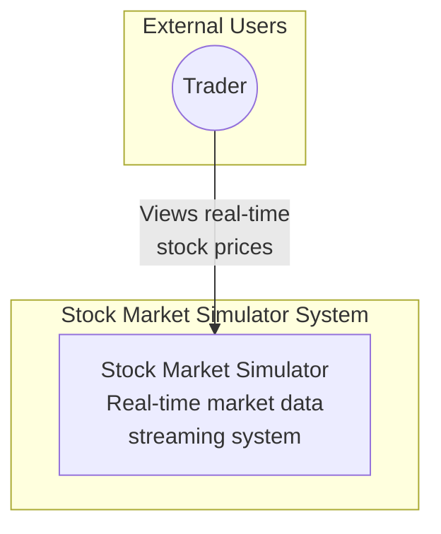
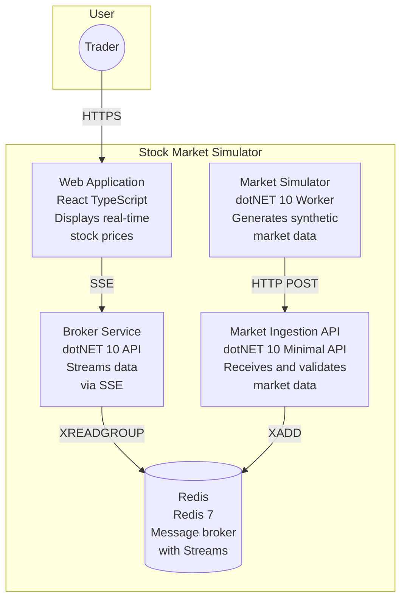
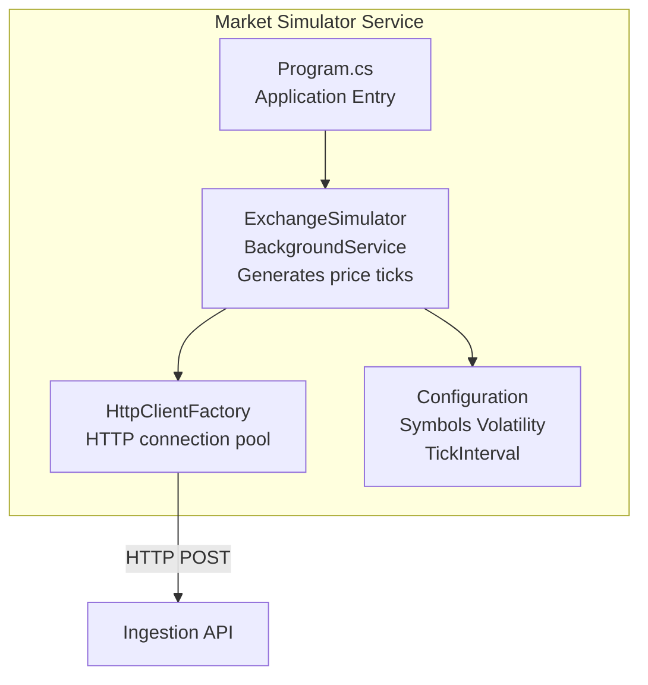
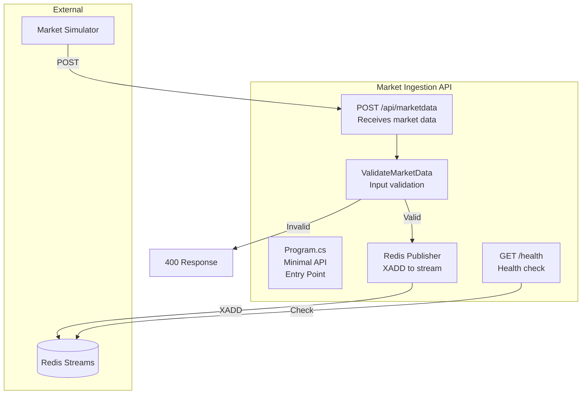
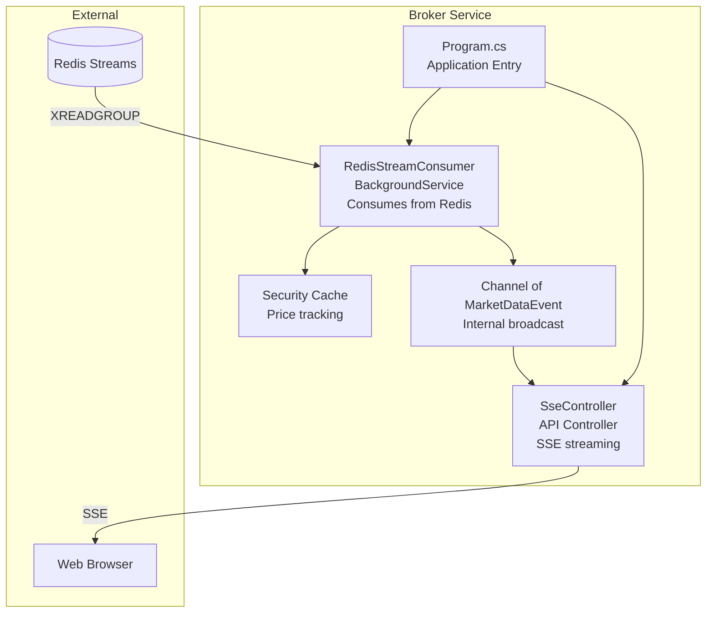
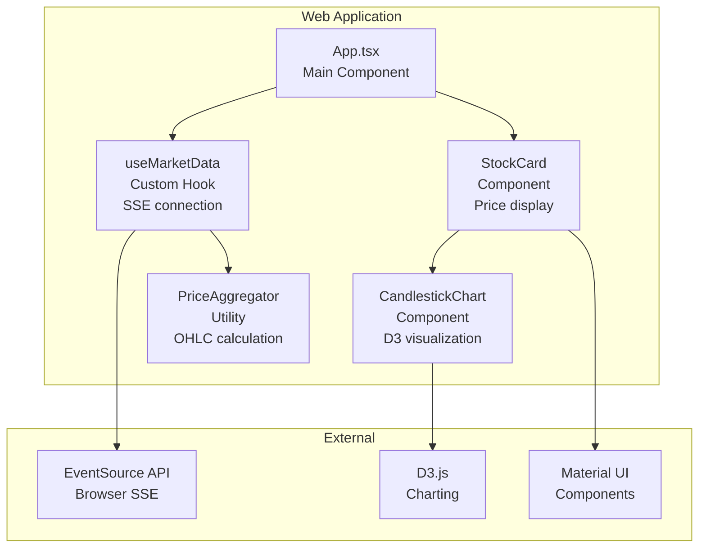
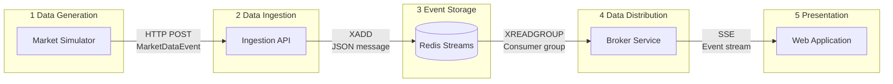
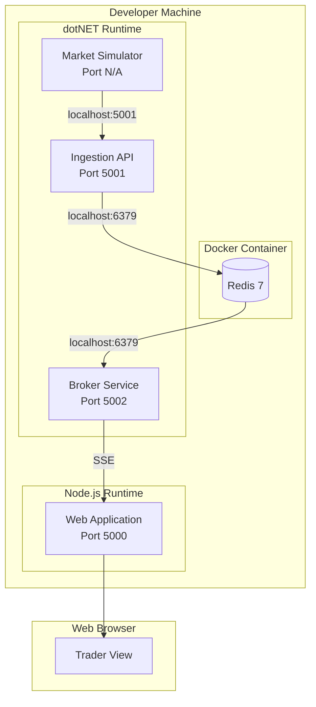
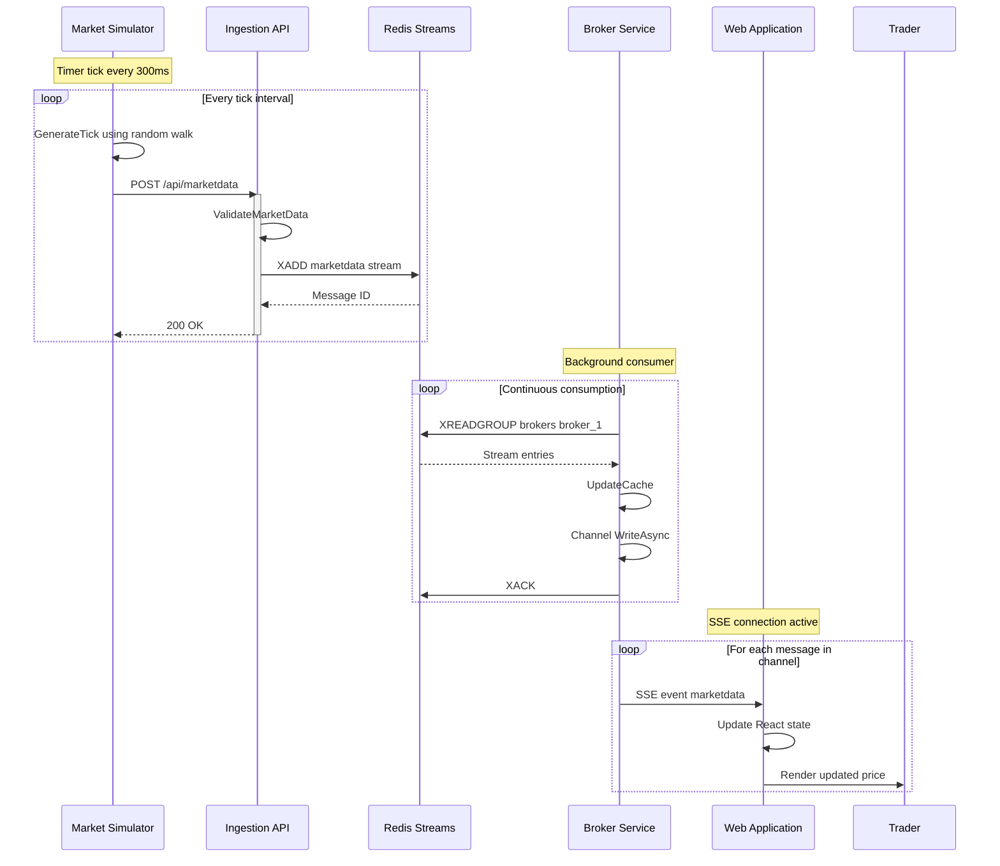
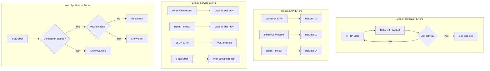

# C4 Model Diagrams
## Stock Market Simulator

This document contains C4 model diagrams in Mermaid format for the Stock Market Simulator system.

---

## Level 1: System Context Diagram

Shows the Stock Market Simulator system and its relationship with users.

**Description**: The Trader interacts with the Stock Market Simulator to view real-time stock price updates. This is a demonstration system that generates synthetic market data.

---

## Level 2: Container Diagram

Shows the high-level technology choices and how containers communicate.

**Container Descriptions**:

| Container | Technology | Responsibility |
|-----------|-----------|---------------|
| Web Application | React, TypeScript, Material UI | User interface for viewing prices |
| Broker Service | .NET 10, ASP.NET Core | Consumes from Redis, streams via SSE |
| Market Ingestion API | .NET 10 Minimal API | Validates and publishes market data |
| Market Simulator | .NET 10 Worker Service | Generates synthetic price ticks |
| Redis | Redis 7 with Streams | Message broker and event store |

---

## Level 3: Component Diagrams

### 3.1 Market Simulator Components

**Component Descriptions**:

| Component | Type | Responsibility |
|-----------|------|---------------|
| Program.cs | Entry Point | Configures DI and starts host |
| ExchangeSimulator | BackgroundService | Generates ticks using random walk |
| HttpClientFactory | Factory | Manages HTTP connections |
| Configuration | IConfiguration | Provides runtime settings |

---

### 3.2 Market Ingestion API Components

**Component Descriptions**:

| Component | Type | Responsibility |
|-----------|------|---------------|
| Program.cs | Minimal API | Defines routes and middleware |
| POST /api/marketdata | Endpoint | Receives and processes market data |
| GET /health | Endpoint | Reports service health |
| ValidateMarketData | Function | Validates input data |
| Redis Publisher | Service | Publishes to Redis Streams |

---

### 3.3 Broker Service Components

**Component Descriptions**:

| Component | Type | Responsibility |
|-----------|------|---------------|
| Program.cs | Entry Point | Configures services and middleware |
| RedisStreamConsumer | BackgroundService | Consumes messages from Redis |
| SseController | ApiController | Handles SSE client connections |
| Channel | Channel&lt;T&gt; | Broadcast buffer for SSE |
| Security Cache | Dictionary | Tracks latest prices |

---

### 3.4 Web Application Components

**Component Descriptions**:

| Component | Type | Responsibility |
|-----------|------|---------------|
| App.tsx | React Component | Main application layout |
| useMarketData | Custom Hook | Manages SSE connection and state |
| StockCard | React Component | Displays individual security |
| CandlestickChart | React Component | Renders D3 candlestick chart |
| PriceAggregator | Utility Class | Aggregates ticks into OHLC |

---

## Data Flow Diagram

---

## Deployment Diagram

---

## Sequence Diagram: Complete Data Flow

---

## Error Handling Flow

---

## References

- [C4 Model](https://c4model.com/)
- [Mermaid Diagrams](https://mermaid.js.org/)
- [High-Level Design](./HIGH_LEVEL_DESIGN.md)
- [Low-Level Design](./LOW_LEVEL_DESIGN.md)
