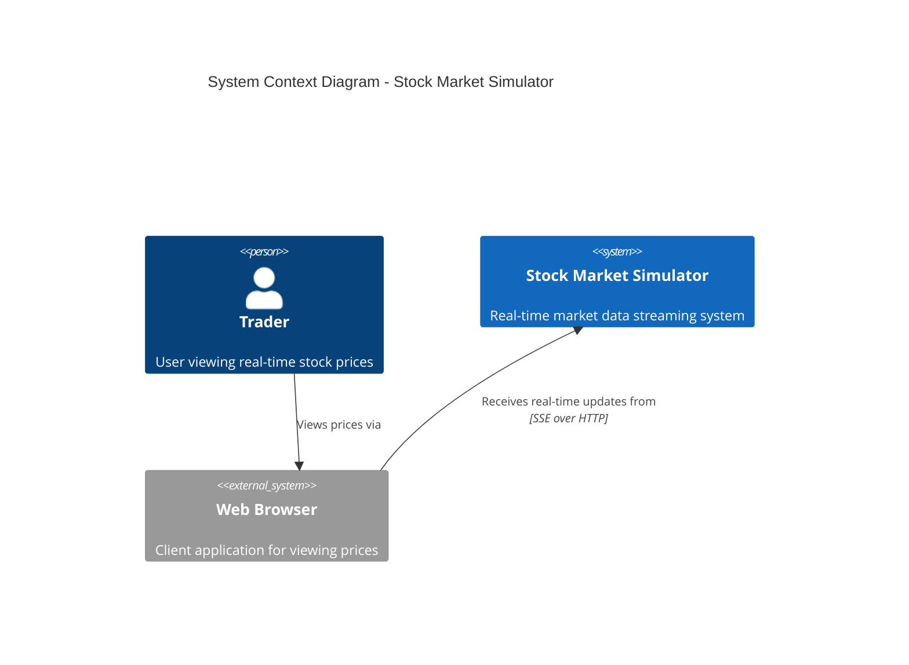
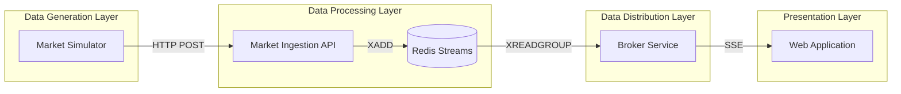
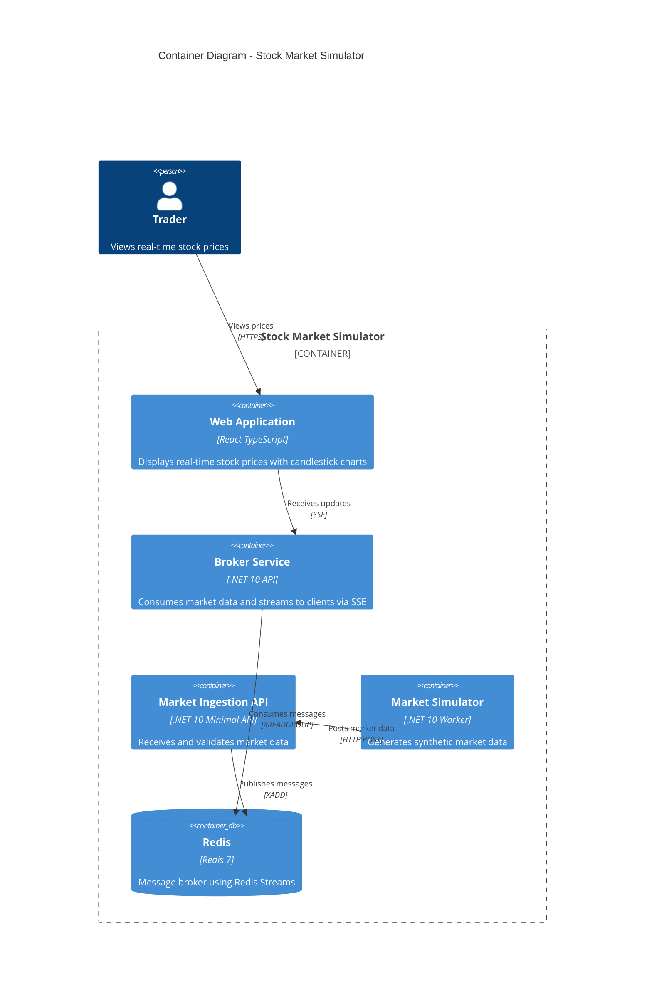
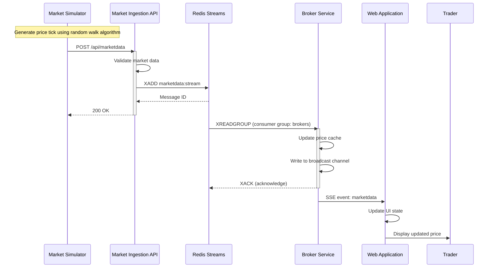
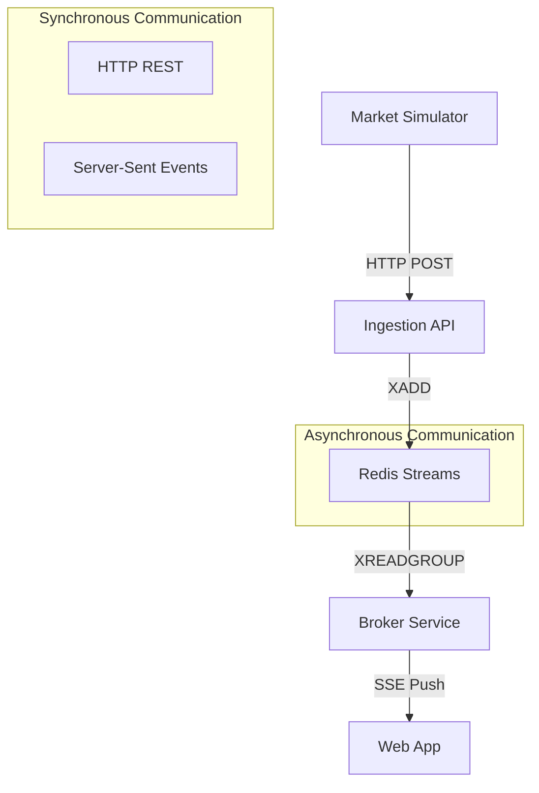
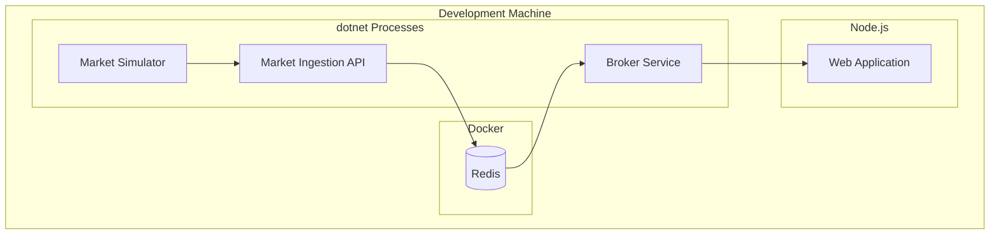

# High-Level Design (HLD)
## Stock Market Simulator

**Version:** 1.0  
**Date:** January 2026  
**Status:** Complete (Demo/Portfolio Project)

---

## 1. Executive Summary

The Stock Market Simulator is a real-time stock market data simulation system designed to demonstrate streaming architectures using modern cloud-native technologies. The system generates synthetic market data, processes it through a distributed pipeline, and delivers live updates to web clients using Server-Sent Events (SSE).

### Key Business Objectives
- **Educational Purpose**: Teach event-driven architecture patterns
- **Portfolio Demonstration**: Showcase modern .NET development skills
- **Architecture Showcase**: Demonstrate scalable streaming data pipelines

### Target Users
- Developers learning real-time data architectures
- Technical stakeholders evaluating streaming solutions
- End users exploring simulated stock market data

---

## 2. System Overview

The Stock Market Simulator follows a modular microservices architecture with clear separation of concerns. Data flows from generation through processing to delivery in a unidirectional pipeline.

### 2.1 Context Diagram (C4 Level 1)

### 2.2 High-Level Architecture

---

## 3. Component Architecture

### 3.1 Container Diagram (C4 Level 2)

### 3.2 Component Responsibilities

| Component | Technology | Primary Responsibility | Port |
|-----------|-----------|----------------------|------|
| Market Simulator | .NET 10 Worker Service | Generate synthetic price ticks | N/A |
| Market Ingestion API | .NET 10 Minimal API | Validate and publish to Redis | 5001 |
| Redis | Redis 7 with Streams | Message broker and event store | 6379 |
| Broker Service | .NET 10 Web API | Consume from Redis and SSE broadcast | 5002 |
| Web Application | React + TypeScript | Display real-time prices | 5000 |

---

## 4. Data Flow

### 4.1 End-to-End Data Flow Sequence

### 4.2 Data Transformation

1. **Generation**: `ExchangeSimulator` creates `MarketDataEvent` with symbol, price, volume, timestamp
2. **Ingestion**: API validates data and serializes to JSON
3. **Storage**: Redis Streams stores as key-value entry
4. **Consumption**: Broker deserializes and updates local cache
5. **Broadcasting**: SSE formats as `event: marketdata\ndata: {json}\n\n`
6. **Display**: React component renders price with change indicators

---

## 5. Technology Stack

### 5.1 Backend Technologies

| Technology | Version | Purpose |
|------------|---------|---------|
| .NET | 10 | Runtime platform |
| ASP.NET Core | 10 | Web API framework |
| StackExchange.Redis | Latest | Redis client library |
| Aspire | 13.1.0 | Cloud-native orchestration |

### 5.2 Frontend Technologies

| Technology | Version | Purpose |
|------------|---------|---------|
| React | 19+ | UI framework |
| TypeScript | 5.9+ | Type safety |
| Material UI | 7+ | Component library |
| D3.js | 7+ | Candlestick charts |
| Vite | 7+ | Build tool |

### 5.3 Infrastructure

| Technology | Version | Purpose |
|------------|---------|---------|
| Redis | 7+ | Message broker and streams |
| Docker | Latest | Container runtime |

---

## 6. Integration Patterns

### 6.1 Communication Protocols

### 6.2 Pattern Summary

| Pattern | Implementation | Use Case |
|---------|---------------|----------|
| Request-Response | HTTP POST | Simulator to Ingestion API |
| Pub/Sub with Consumer Groups | Redis Streams | Ingestion to Broker |
| Server Push | SSE | Broker to Web Clients |
| Background Processing | BackgroundService | Simulator and Broker consumers |

---

## 7. Deployment Architecture

### 7.1 Local Development

### 7.2 Service Endpoints

| Service | URL | Purpose |
|---------|-----|---------|
| Market Ingestion API | http://localhost:5001 | Receive market data |
| Broker Service | http://localhost:5002 | SSE streaming |
| Web Frontend | http://localhost:5173 | User interface (Vite dev server) |
| Redis | localhost:6379 | Message broker |

---

## 8. Quality Attributes

### 8.1 Performance Requirements

| Metric | Target | Rationale |
|--------|--------|-----------|
| End-to-end latency | Less than 300ms (p95) | Acceptable for demo |
| Throughput | 100+ ticks/second | Supports multiple symbols |
| Concurrent users | 100+ SSE connections | Browser limitations |

### 8.2 Reliability Features

- **Retry Logic**: Exponential backoff for HTTP calls
- **Consumer Groups**: Redis ensures at-least-once delivery
- **Auto-reconnect**: SSE EventSource handles reconnection
- **Health Checks**: Redis connectivity monitoring

### 8.3 Scalability Considerations

- **Horizontal Scaling**: Multiple Broker instances via consumer groups
- **Message Retention**: Redis Streams with configurable max length
- **Stateless Services**: Ingestion API is fully stateless

---

## 9. Security Considerations

### 9.1 Current Implementation

- CORS enabled for localhost origins
- Input validation on all API endpoints
- No authentication (demo system)

### 9.2 Production Recommendations

- Enable HTTPS for all endpoints
- Implement API authentication
- Add rate limiting
- Secure Redis with password

---

## 10. Monitoring and Observability

### 10.1 Built-in Capabilities

- **Logging**: Structured logging via Microsoft.Extensions.Logging
- **Health Checks**: Redis connectivity via AspNetCore.HealthChecks
- **OpenTelemetry**: Aspire provides distributed tracing

### 10.2 Key Metrics

| Metric | Source | Purpose |
|--------|--------|---------|
| Messages published | Ingestion API logs | Throughput monitoring |
| Consumer lag | Redis XPENDING | Backpressure detection |
| Active connections | Broker Service logs | User engagement |

---

## 11. Future Roadmap

### Phase 2 Enhancements
- Docker Compose orchestration
- WebSocket support
- Additional chart types
- Historical data storage

### Phase 3 Enhancements
- Authentication and authorization
- Multi-tenant support
- Cloud deployment (Azure Container Apps)
- Performance optimization

---

## 12. References

- [Low-Level Design Document](./LOW_LEVEL_DESIGN.md)
- [Architecture Decision Records](./ADR/)
- [Product Requirements](../requirements/prd.md)
- [Technical Approach](../plan/draft-technical-approach.md)
