# Low-Level Design (LLD)
## Stock Market Simulator

**Version:** 1.0  
**Date:** January 2026  
**Status:** Production Ready

---

## 1. Introduction

This document provides detailed technical specifications for each component in the Stock Market Simulator system. It covers class structures, data models, algorithms, and implementation details.

---

## 2. Shared Contracts Module

### 2.1 Component Diagram

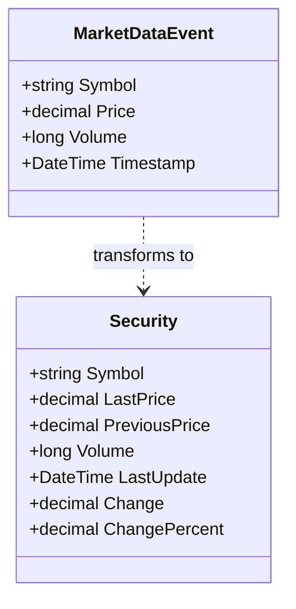

### 2.2 MarketDataEvent Class

**Purpose**: Represents a single market data tick event transmitted through the system.

**Properties**:

| Property | Type | Description | Validation |
|----------|------|-------------|------------|
| Symbol | string | Stock ticker symbol (e.g., NIFTY50) | Required, not empty |
| Price | decimal | Last traded price | Must be positive |
| Volume | long | Trading volume for the tick | Cannot be negative |
| Timestamp | DateTime | UTC timestamp of the event | Cannot be future |

**Business Logic**:
- Immutable record type ensures thread safety
- Simple model focused on MVP requirements
- Supports JSON serialization for API and Redis transport

### 2.3 Security Class

**Purpose**: Represents cached security information for tracking price changes.

**Properties**:

| Property | Type | Description | Computed |
|----------|------|-------------|----------|
| Symbol | string | Stock ticker symbol | No |
| LastPrice | decimal | Current price | No |
| PreviousPrice | decimal | Previous tick price | No |
| Volume | long | Current volume | No |
| LastUpdate | DateTime | Last update timestamp | No |
| Change | decimal | Price change | Yes |
| ChangePercent | decimal | Percentage change | Yes |

**Business Logic**:
- `Change = LastPrice - PreviousPrice`
- `ChangePercent = (Change / PreviousPrice) * 100` when PreviousPrice > 0

---

## 3. Market Simulator Component

### 3.1 Component Overview

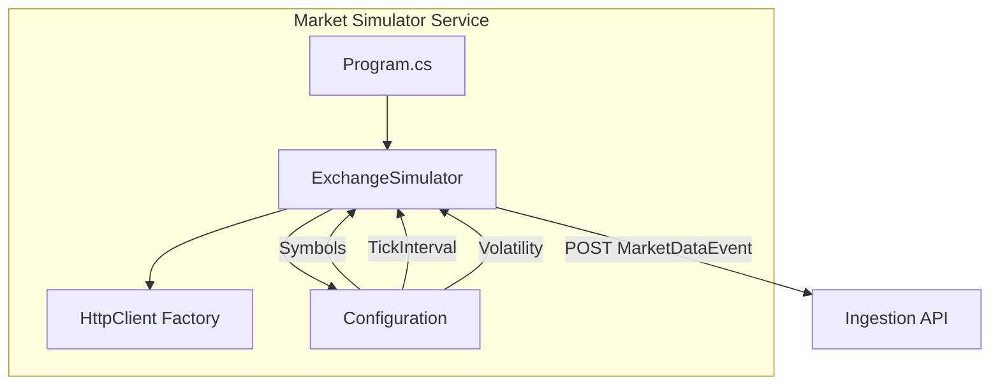

### 3.2 ExchangeSimulator Class

**Purpose**: Background service that generates synthetic market data using a random walk algorithm.

**Class Diagram**:

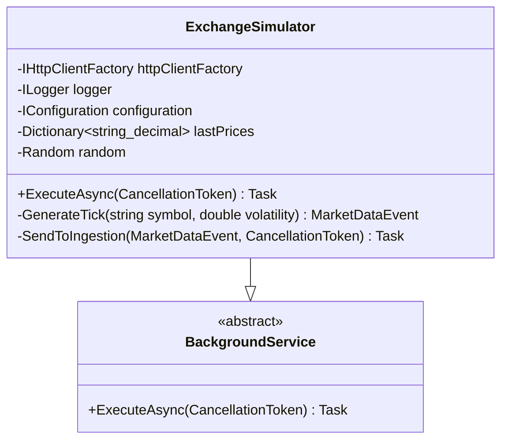

### 3.3 Price Generation Algorithm

**Random Walk Implementation**:

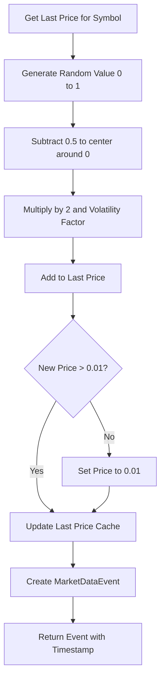

**Configuration Parameters**:

| Parameter | Default | Description |
|-----------|---------|-------------|
| Symbols | NIFTY50, BANKNIFTY | Stock symbols to simulate |
| TickIntervalMs | 300 | Milliseconds between ticks |
| Volatility | 0.5 | Price change magnitude |
| InitialPrice | 1000 | Starting price for all symbols |

### 3.4 Retry Logic

**Exponential Backoff Strategy**:

| Attempt | Delay | Action |
|---------|-------|--------|
| 1 | 100ms | First retry |
| 2 | 200ms | Second retry |
| 3 | N/A | Give up, log error |

**Error Handling**:
- `HttpRequestException`: Retry with backoff
- `TaskCanceledException`: Retry (timeout scenario)
- Other exceptions: Log and skip message

---

## 4. Market Ingestion API Component

### 4.1 Component Overview

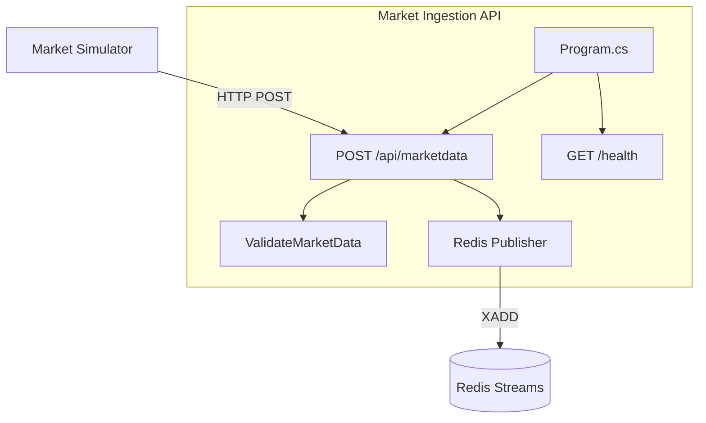

### 4.2 API Endpoint Specification

**POST /api/marketdata**

| Aspect | Details |
|--------|---------|
| Method | POST |
| Content-Type | application/json |
| Request Body | MarketDataEvent JSON |
| Success Response | 200 OK with messageId |
| Validation Error | 400 ValidationProblem |
| Redis Error | 503/504 Problem |

### 4.3 Validation Rules

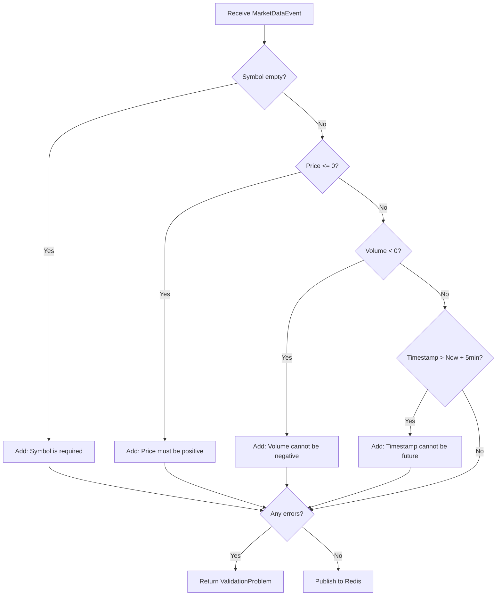

### 4.4 Redis Publishing

**Stream Configuration**:

| Parameter | Value | Purpose |
|-----------|-------|---------|
| Stream Key | marketdata:stream | Stream identifier |
| Field Name | data | JSON data field |
| Max Length | 10000 | Approximate message limit |
| Approximate | true | Performance optimization |

**Redis Command Sequence**:
1. Serialize `MarketDataEvent` to JSON
2. Execute `XADD marketdata:stream MAXLEN ~ 10000 * data {json}`
3. Return generated message ID

---

## 5. Broker Service Component

### 5.1 Component Overview

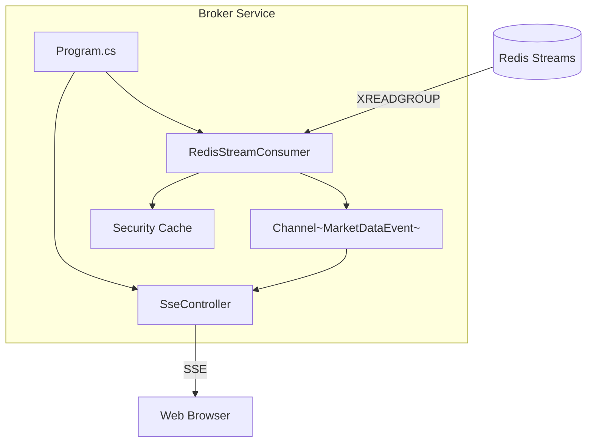

### 5.2 RedisStreamConsumer Class

**Class Diagram**:

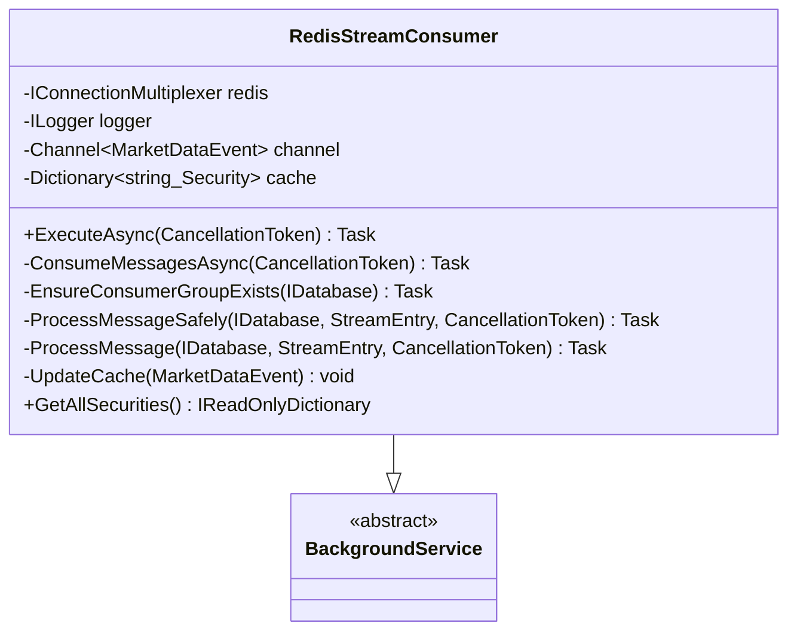

### 5.3 Consumer Group Pattern

**Configuration**:

| Parameter | Value | Purpose |
|-----------|-------|---------|
| Stream Key | marketdata:stream | Source stream |
| Consumer Group | brokers | Group identifier |
| Consumer Name | broker-1 | Instance identifier |
| Read Count | 10 | Messages per read |

**Message Processing Flow**:

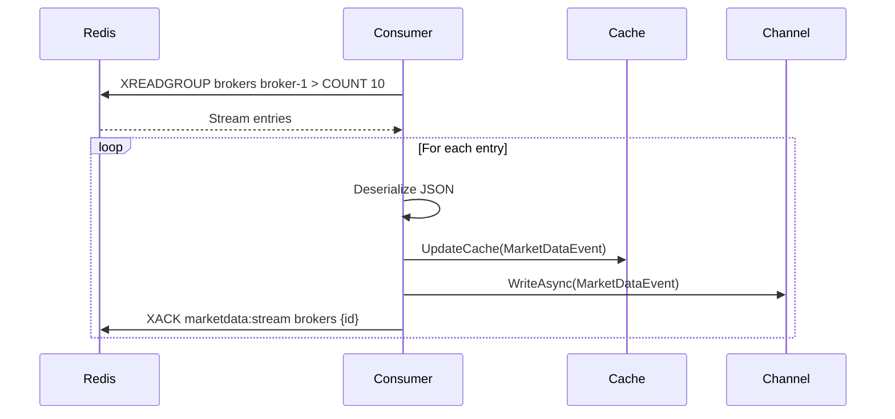

### 5.4 Error Handling Strategy

| Error Type | Action | Retry Delay |
|------------|--------|-------------|
| RedisConnectionException | Reconnect | 5 seconds |
| RedisTimeoutException | Retry | 2 seconds |
| JsonException | ACK and skip | Immediate |
| Other Exception | Restart consumer | 10 seconds |

### 5.5 SseController Class

**Class Diagram**:

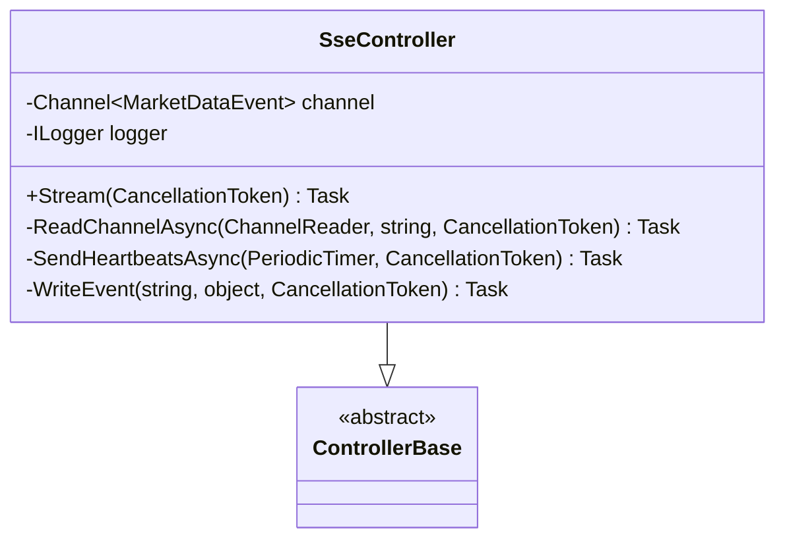

### 5.6 SSE Protocol Implementation

**Event Types**:

| Event | Data | Purpose |
|-------|------|---------|
| connected | clientId, timestamp | Connection confirmation |
| marketdata | MarketDataEvent | Price update |
| heartbeat | timestamp | Keep-alive |

**SSE Message Format**:
```
event: {eventName}
data: {json}

```

**Headers Set**:
- Content-Type: text/event-stream
- Cache-Control: no-cache
- Connection: keep-alive

### 5.7 Connection Lifecycle

```mermaid
stateDiagram_v2
    [*] --> Connected: Client connects
    Connected --> Streaming: Send connected event
    Streaming --> Streaming: Send marketdata events
    Streaming --> Streaming: Send heartbeat every 15s
    Streaming --> Disconnected: Client disconnects
    Streaming --> Disconnected: Error occurs
    Disconnected --> [*]
```

---

## 6. Web Application Component

### 6.1 Component Overview

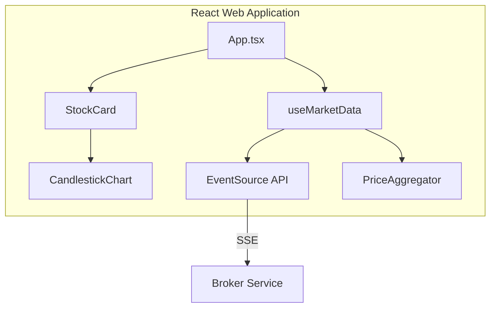

### 6.2 useMarketData Hook

**State Management**:

| State | Type | Purpose |
|-------|------|---------|
| securities | Map<string, Security> | Current security data |
| isConnected | boolean | Connection status |
| error | string or null | Error message |
| priceHistory | Map<string, OHLC[]> | Candlestick data |
| reconnectAttempts | number | Retry counter |

**Reconnection Strategy**:
- Maximum attempts: 5
- Triggers: EventSource.CLOSED state
- UI feedback: Shows attempt count

### 6.3 Event Handling Flow

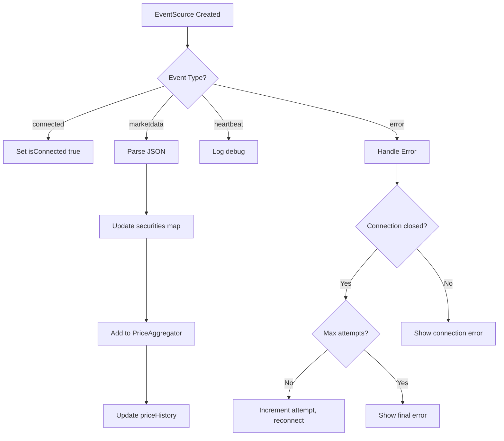

### 6.4 StockCard Component

**Props Interface**:

| Prop | Type | Required |
|------|------|----------|
| security | Security | Yes |
| priceHistory | OHLC[] | No |

**Visual Indicators**:

| Condition | Price Color | Icon |
|-----------|-------------|------|
| change > 0 | Green (success) | TrendingUp |
| change < 0 | Red (error) | TrendingDown |
| change = 0 | Default | TrendingFlat |

### 6.5 CandlestickChart Component

**D3.js Rendering**:

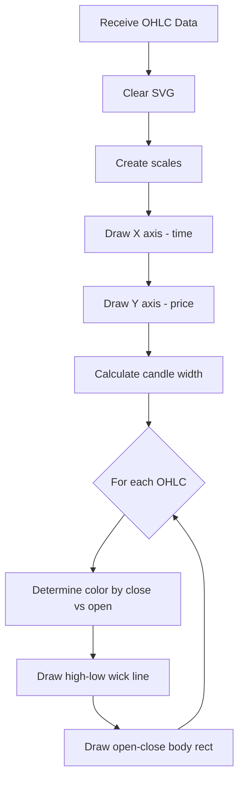

**Configuration**:

| Parameter | Default | Purpose |
|-----------|---------|---------|
| width | 600 | Chart width in pixels |
| height | 300 | Chart height in pixels |
| margin | 20, 30, 30, 50 | Top, right, bottom, left |

---

## 7. Cross-Cutting Concerns

### 7.1 Logging Strategy

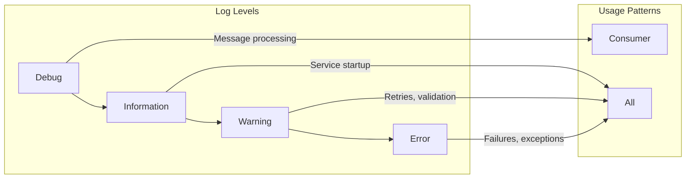

### 7.2 Configuration Hierarchy

| Source | Priority | Use Case |
|--------|----------|----------|
| appsettings.json | Base | Default settings |
| appsettings.Development.json | Override | Development overrides |
| Environment Variables | Highest | Runtime configuration |

### 7.3 Dependency Injection

**Service Registration Pattern**:

| Service | Lifetime | Reason |
|---------|----------|--------|
| IConnectionMultiplexer | Singleton | Redis connection pooling |
| Channel<MarketDataEvent> | Singleton | Shared broadcast channel |
| RedisStreamConsumer | Hosted | Background processing |
| IHttpClientFactory | Singleton | HTTP connection pooling |

---

## 8. Data Flow Specifications

### 8.1 Message Schema

**MarketDataEvent JSON**:
```json
{
  "symbol": "NIFTY50",
  "price": 1000.50,
  "volume": 5000,
  "timestamp": "2026-01-22T10:30:00Z"
}
```

### 8.2 Redis Stream Entry

**Storage Format**:
```
ID: 1737500000000-0
Field: data
Value: {"symbol":"NIFTY50","price":1000.50,"volume":5000,"timestamp":"2026-01-22T10:30:00Z"}
```

### 8.3 SSE Event Format

**Wire Format**:
```
event: marketdata
data: {"symbol":"NIFTY50","price":1000.50,"volume":5000,"timestamp":"2026-01-22T10:30:00Z"}

```

---

## 9. Performance Considerations

### 9.1 Bottleneck Analysis

| Component | Potential Bottleneck | Mitigation |
|-----------|---------------------|------------|
| Market Simulator | HTTP connection overhead | Connection pooling |
| Ingestion API | Redis write latency | Approximate MAXLEN |
| Broker Consumer | Message processing rate | Batch reading (count: 10) |
| SSE Controller | Many concurrent connections | Channel fan-out pattern |

### 9.2 Memory Management

| Component | Memory Pattern | Strategy |
|-----------|---------------|----------|
| Price Cache | Bounded by symbol count | Dictionary with known keys |
| Redis Stream | Bounded by MAXLEN | Automatic trimming |
| OHLC History | Bounded by aggregator | Sliding window (30 candles) |
| Channel | Unbounded | Single writer, fast consumers |

---

## 10. Testing Approach

### 10.1 Unit Testing

| Component | Test Focus |
|-----------|------------|
| MarketDataEvent | Property validation |
| Security | Change calculations |
| ValidateMarketData | All validation rules |
| GenerateTick | Price bounds, randomness |

### 10.2 Integration Testing

| Scenario | Components | Verification |
|----------|------------|--------------|
| End-to-end flow | All | Price appears in UI |
| Redis failure | Ingestion, Broker | Error handling |
| Client disconnect | Broker | Resource cleanup |

---

## 11. References

- [High-Level Design](./HIGH_LEVEL_DESIGN.md)
- [Architecture Decision Records](./ADR/)
- [Technical Approach](../plan/draft-technical-approach.md)
