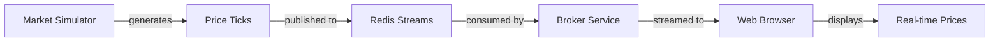

# Stock Market Simulator Documentation

Welcome to the comprehensive documentation for the Stock Market Simulator project. This documentation is designed for both technical and non-technical stakeholders.

---

## Quick Links

| Document | Description | Audience |
|----------|-------------|----------|
| [High-Level Design](./HIGH_LEVEL_DESIGN.md) | System overview and architecture | All stakeholders |
| [Low-Level Design](./LOW_LEVEL_DESIGN.md) | Detailed component specifications | Developers |
| [C4 Diagrams](./C4_DIAGRAMS.md) | Visual architecture diagrams | All stakeholders |
| [ADR Index](./ADR/README.md) | Architecture decision records | Technical leads |

---

## Executive Summary

### What is Stock Market Simulator?

The Stock Market Simulator is a **real-time stock market data simulation system** that demonstrates modern streaming architectures. It generates synthetic market data and delivers it to web browser clients in real-time.

### Key Business Value

- **Educational Tool**: Learn event-driven architecture patterns
- **Technical Demonstration**: Showcase modern .NET development capabilities  
- **Architecture Reference**: Reference implementation for streaming data pipelines

### System at a Glance



---

## For Non-Technical Stakeholders

### How Does It Work?

1. **Data Generation**: The system continuously generates realistic stock price changes for configured symbols (like NIFTY50, BANKNIFTY)

2. **Data Processing**: Each price update is validated and stored in a message queue

3. **Data Delivery**: Price updates are instantly pushed to all connected users

4. **User Display**: Users see live updating price cards with:
   - Current price with currency symbol
   - Price change (green for up, red for down)
   - Trading volume
   - Interactive candlestick charts

### Key Features

| Feature | Benefit |
|---------|---------|
| Real-time Updates | Prices update multiple times per second |
| Auto-reconnection | System recovers from network issues |
| Visual Indicators | Color-coded price changes |
| Candlestick Charts | Technical analysis visualization |

---

## For Technical Stakeholders

### Technology Stack Summary

| Layer | Technology | Purpose |
|-------|------------|---------|
| Frontend | React + TypeScript | User interface |
| API Gateway | ASP.NET Core | HTTP and SSE endpoints |
| Message Broker | Redis Streams | Event distribution |
| Orchestration | .NET Aspire | Service management |

### Architecture Patterns

| Pattern | Implementation |
|---------|---------------|
| Event Streaming | Redis Streams with consumer groups |
| Server Push | Server-Sent Events (SSE) |
| Background Processing | .NET BackgroundService |
| Microservices | Separate deployment units |

### Getting Started for Developers

1. **Prerequisites**
   - .NET 10.0.102+ SDK
   - Docker Desktop
   - Node.js 18+

2. **Quick Start**
   ```bash
   ./run-services.sh
   ```

3. **Service Endpoints**
   - Web UI: http://localhost:5000
   - Ingestion API: http://localhost:5001
   - Broker SSE: http://localhost:5002

---

## Documentation Structure

```
docs/
├── architecture/
│   ├── README.md                    # This file
│   ├── HIGH_LEVEL_DESIGN.md         # System overview
│   ├── LOW_LEVEL_DESIGN.md          # Component details
│   ├── C4_DIAGRAMS.md               # Visual diagrams
│   └── ADR/
│       ├── README.md                # ADR index
│       ├── ADR-001-redis-streams.md
│       ├── ADR-002-server-sent-events.md
│       ├── ADR-003-dotnet-aspire.md
│       ├── ADR-004-minimal-api.md
│       └── ADR-005-react-typescript.md
├── requirements/
│   ├── prd.md                       # Product requirements
│   └── objective.md                 # Project objectives
└── plan/
    └── draft-technical-approach.md  # Implementation guide
```

---

## Document Descriptions

### High-Level Design (HLD)

**Purpose**: Provides a comprehensive overview of the system architecture for all stakeholders.

**Contents**:
- Executive summary and business objectives
- System context and container diagrams
- Data flow descriptions
- Technology stack overview
- Quality attributes and deployment

**Best For**: Project managers, architects, new team members

---

### Low-Level Design (LLD)

**Purpose**: Detailed technical specifications for developers implementing or maintaining the system.

**Contents**:
- Class diagrams and data models
- Algorithm descriptions
- API specifications
- Error handling strategies
- Performance considerations

**Best For**: Developers, code reviewers, QA engineers

---

### C4 Diagrams

**Purpose**: Visual representation of the system architecture using the C4 model.

**Contents**:
- Context diagram (Level 1)
- Container diagram (Level 2)
- Component diagrams (Level 3)
- Sequence diagrams
- Deployment diagrams

**Best For**: Visual learners, architecture reviews, onboarding

---

### Architecture Decision Records (ADR)

**Purpose**: Documents the key architectural decisions made during system design.

**Available ADRs**:
| ADR | Decision |
|-----|----------|
| [ADR-001](./ADR/ADR-001-redis-streams.md) | Why Redis Streams for messaging |
| [ADR-002](./ADR/ADR-002-server-sent-events.md) | Why SSE for client push |
| [ADR-003](./ADR/ADR-003-dotnet-aspire.md) | Why .NET Aspire for orchestration |
| [ADR-004](./ADR/ADR-004-minimal-api.md) | Why Minimal API for ingestion |
| [ADR-005](./ADR/ADR-005-react-typescript.md) | Why React + TypeScript |

**Best For**: Understanding tradeoffs, future architects, code reviewers

---

## Key Concepts Explained

### What is Redis Streams?

Redis Streams is a data structure that acts like an append-only log. Messages are:
- Stored with automatic IDs
- Consumed by consumer groups
- Acknowledged after processing
- Automatically trimmed to prevent unbounded growth

### What are Server-Sent Events (SSE)?

SSE is a standard for servers to push updates to web browsers:
- Uses standard HTTP connections
- Automatic reconnection built into browsers
- Simpler than WebSockets for one-way push
- Works through corporate firewalls

### What is .NET Aspire?

.NET Aspire is a framework for building cloud-native .NET applications:
- Orchestrates multiple services
- Provides built-in observability
- Manages service discovery
- Simplifies local development

---

## Contributing to Documentation

When updating documentation:

1. **Keep diagrams updated**: Mermaid diagrams should reflect current architecture
2. **Use alphanumeric labels**: Mermaid requires alphanumeric characters and underscores
3. **Update the index**: Add new documents to this README
4. **Follow the structure**: Maintain consistency across documents

---

## Related Resources

- [Project README](../../README.md) - Quick start guide
- [Memory Documents](../../memory/) - Development logs and notes
- [Test Suite](../../tests/) - Automated tests
