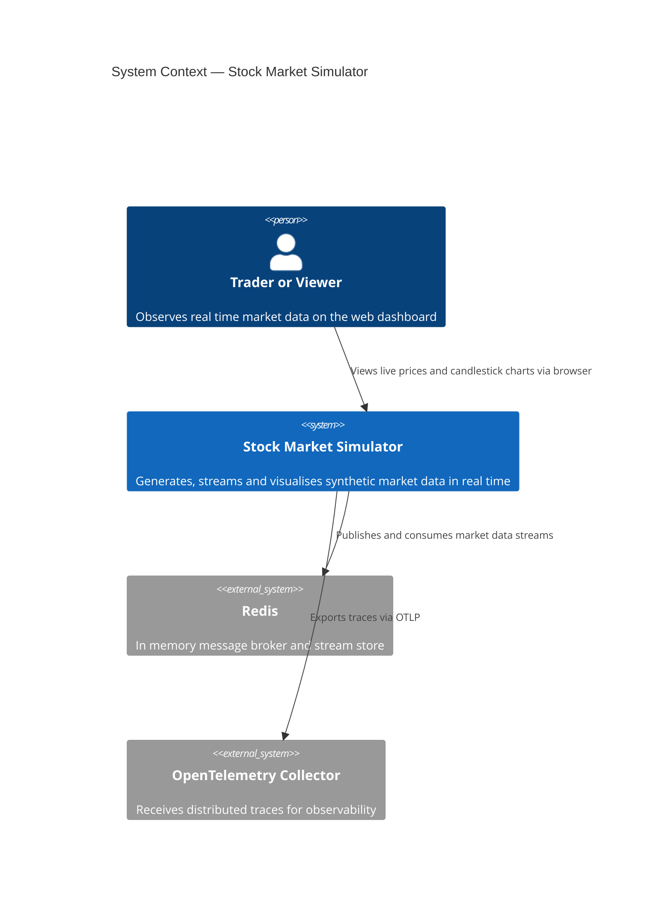
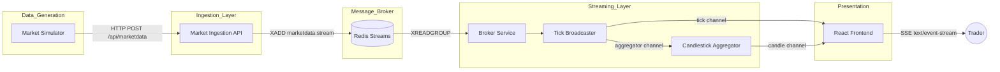
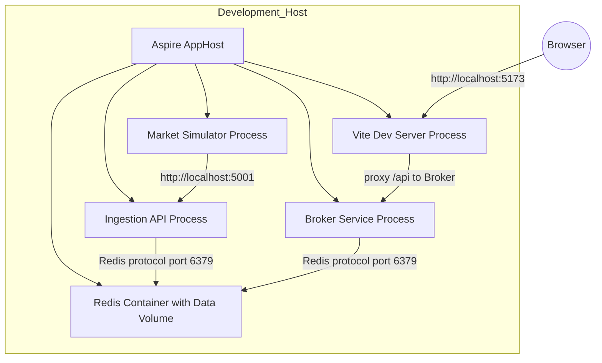

# High-Level Design (HLD) — Stock Market Simulator

> **Version:** 1.0  
> **Last Updated:** 2026-02-07  
> **Audience:** Technical and non-technical stakeholders, architects, product owners

---

## 1. Executive Summary

The **Stock Market Simulator** is a real-time data streaming platform that mimics the behaviour of a stock exchange. It generates synthetic but statistically realistic market data (price ticks) for Indian equity symbols (NIFTY50, BANKNIFTY, RELIANCE, TCS), streams them through a message broker, aggregates them into candlestick charts, and delivers them to a web-based trading dashboard in real time.

The system demonstrates a production-grade event-driven architecture using **.NET 10**, **Redis Streams**, **Server-Sent Events (SSE)**, and a **React / TypeScript** frontend — all orchestrated by **.NET Aspire**.

---

## 2. Business Context

### What problem does it solve?

| Concern | How the system addresses it |
|---|---|
| **Realistic simulation** | Geometric Brownian Motion + mean reversion + GARCH volatility clustering produce chart patterns indistinguishable from real tick data. |
| **Real-time delivery** | Sub-second end-to-end latency from price generation to browser rendering via Redis Streams + SSE. |
| **Scalability pattern** | Consumer groups allow horizontal scaling of broker instances without message duplication. |
| **Resilience** | Retry logic, reconnection, heartbeats, and SSE replay with `Last-Event-ID` ensure the system recovers gracefully from transient failures. |

---

## 3. System Architecture Overview

### Data Flow Summary (plain English)

1. **Market Simulator** creates a price tick every 300 ms for each configured symbol by applying a mathematical pricing model.
2. Each tick is sent as an HTTP POST to the **Market Ingestion API**.
3. The Ingestion API validates the data and appends it to a **Redis Stream** (`marketdata:stream`).
4. The **Broker Service** reads new messages from the Redis Stream using a consumer group.
5. The **Tick Broadcaster** fans out each tick to two internal channels:
   - The **SSE channel** (for immediate per-tick streaming to browsers).
   - The **Candlestick Aggregator** (for OHLCV candle construction).
6. The **Candlestick Aggregator** accumulates ticks into 1-minute candle bars and emits throttled updates.
7. Both tick and candle events are multiplexed into a single **SSE stream** and pushed to the **React Frontend**.
8. The frontend renders a live watchlist, a ticker strip, and interactive D3.js candlestick charts.

---

## 4. Component Inventory

| Component | Technology | Port | Responsibility |
|---|---|---|---|
| **AppHost** | .NET Aspire 13.1 | — | Orchestrates all services, manages resource dependencies, injects connection strings |
| **Market Simulator** | .NET 10 Worker Service | — | Generates synthetic price ticks using a realistic pricing engine |
| **Market Ingestion API** | ASP.NET Core 10 Minimal API | 5001 | Validates and publishes market data to Redis Streams |
| **Broker Service** | ASP.NET Core 10 Controllers | 5002 | Consumes from Redis, aggregates candles, streams via SSE |
| **Redis** | Redis 7+ (Docker) | 6379 | Message broker and stream storage |
| **Web Frontend** | React 19, TypeScript 5.9, Vite 7 | 5173 | Real-time trading dashboard with candlestick charts |

---

## 5. Key Technical Decisions (Summary)

| Decision | Choice | Rationale |
|---|---|---|
| Message broker | Redis Streams | Simpler than Kafka, built-in consumer groups, low latency, already used for caching |
| Real-time push | Server-Sent Events (SSE) | Simpler than WebSockets for unidirectional streaming, native browser support, auto-reconnect |
| Price simulation | GBM + Ornstein-Uhlenbeck + GARCH | Produces statistically realistic price movements with volatility clustering and mean reversion |
| Orchestration | .NET Aspire | Provides service discovery, health checks, resource management, and local development orchestration |
| Frontend charting | D3.js (custom) | Full control over candlestick rendering, crosshair interaction, and TradingView-inspired dark theme styling |
| Backpressure handling | Bounded channels with DropOldest | Prevents memory exhaustion under load; acceptable to lose stale ticks rather than block producers |

---

## 6. Non-Functional Requirements

| Attribute | Target | Mechanism |
|---|---|---|
| **Latency** | < 500 ms tick-to-browser | In-memory channels, SSE persistent connections |
| **Throughput** | ~13 ticks/second (4 symbols × 300 ms) | Configurable tick interval and symbol count |
| **Availability** | Auto-reconnect on failure | SSE auto-reconnect, Redis consumer retry loops, exponential backoff on HTTP calls |
| **Observability** | Distributed tracing | OpenTelemetry with OTLP export across all .NET services |
| **Data retention** | Last 10,000 messages in Redis stream | `XADD` with `MAXLEN ~10000` approximate trimming |
| **Scalability** | Horizontal broker scaling | Redis consumer groups distribute messages across broker instances |

---

## 7. Deployment Topology

All services run locally on the developer's machine. Docker Desktop is required only for the Redis container. Aspire manages lifecycle ordering (Redis starts first, then Ingestion API, then Simulator, then Broker, then Frontend).

---

## 8. Security Considerations

| Layer | Current State | Production Recommendation |
|---|---|---|
| API authentication | None (development mode) | Add JWT / API key authentication |
| CORS | Allow all origins in development | Restrict to known origins |
| Redis | No password (local Docker) | Enable ACLs and TLS |
| HTTPS | Optional in development | Enforce TLS termination at load balancer |
| Input validation | Server-side validation on Ingestion API | Add rate limiting and request size limits |

---

## 9. Glossary

| Term | Definition |
|---|---|
| **Tick** | A single price update for one symbol at one moment in time |
| **OHLCV** | Open, High, Low, Close, Volume — the five fields of a candlestick bar |
| **Candlestick** | A chart bar representing price movement over a fixed time interval (1 minute) |
| **SSE** | Server-Sent Events — a W3C standard for one-way server-to-browser streaming over HTTP |
| **Consumer Group** | A Redis Streams feature allowing multiple consumers to share the workload of processing a stream |
| **GBM** | Geometric Brownian Motion — a stochastic process used to model stock prices |
| **Mean Reversion** | The tendency of a price to return toward its long-term average |
| **GARCH** | Generalised Autoregressive Conditional Heteroskedasticity — a model for time-varying volatility |
| **Aspire** | .NET Aspire — a cloud-native application orchestration framework by Microsoft |
