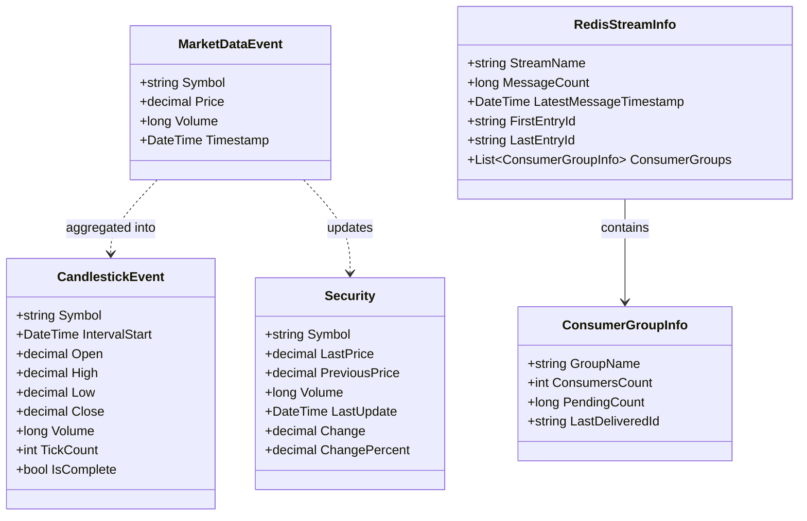
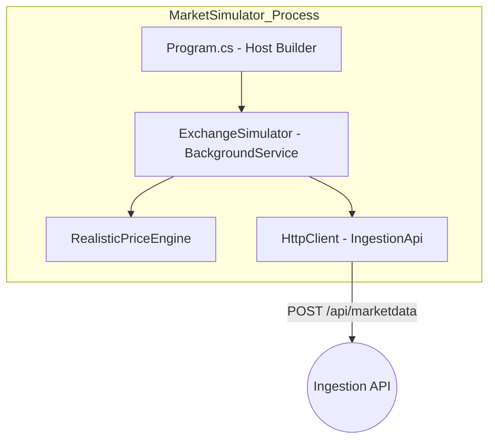
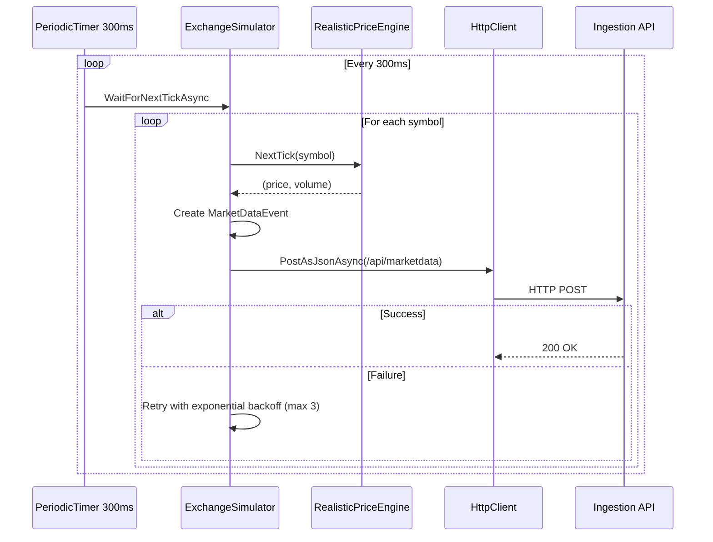
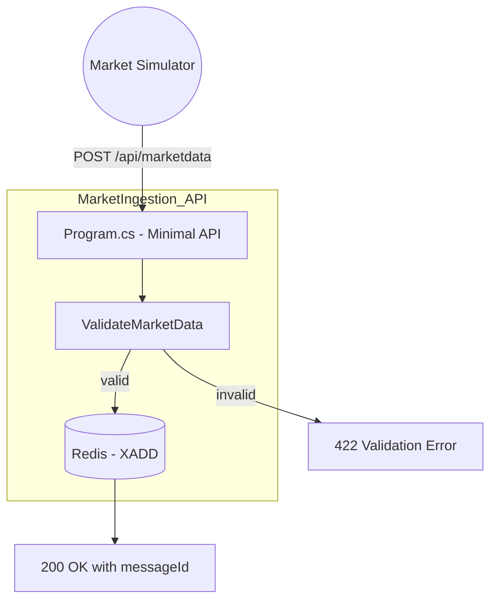
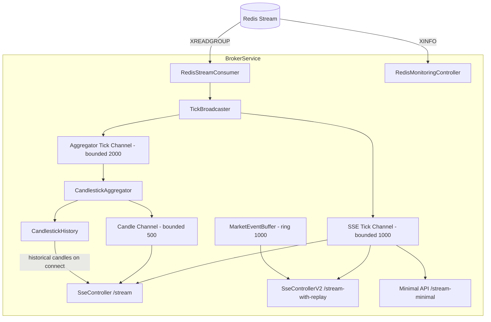
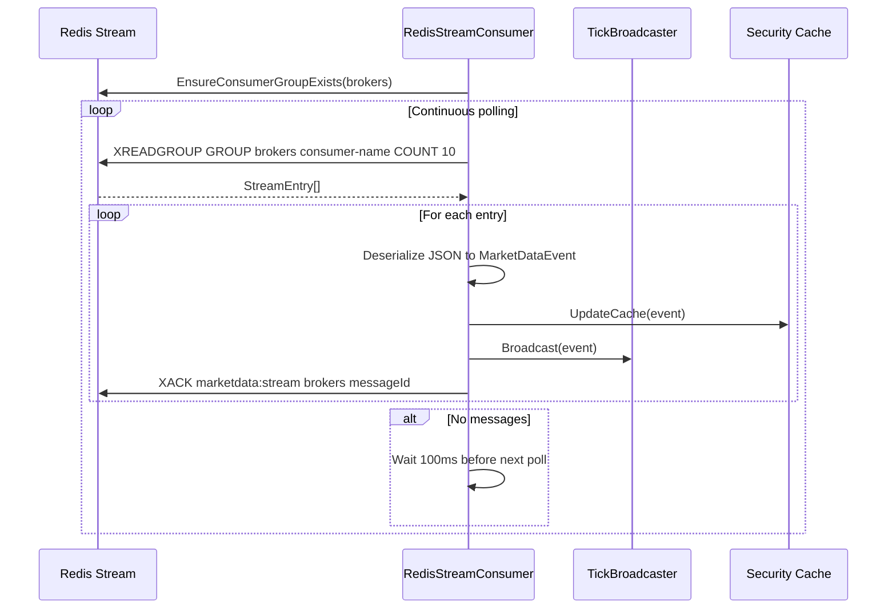
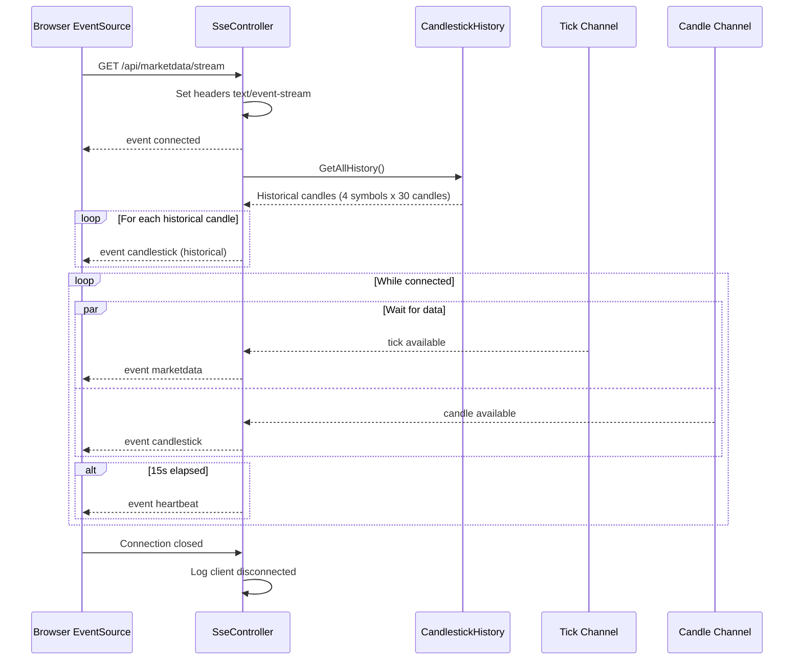
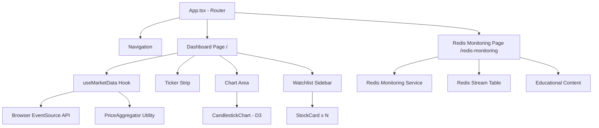
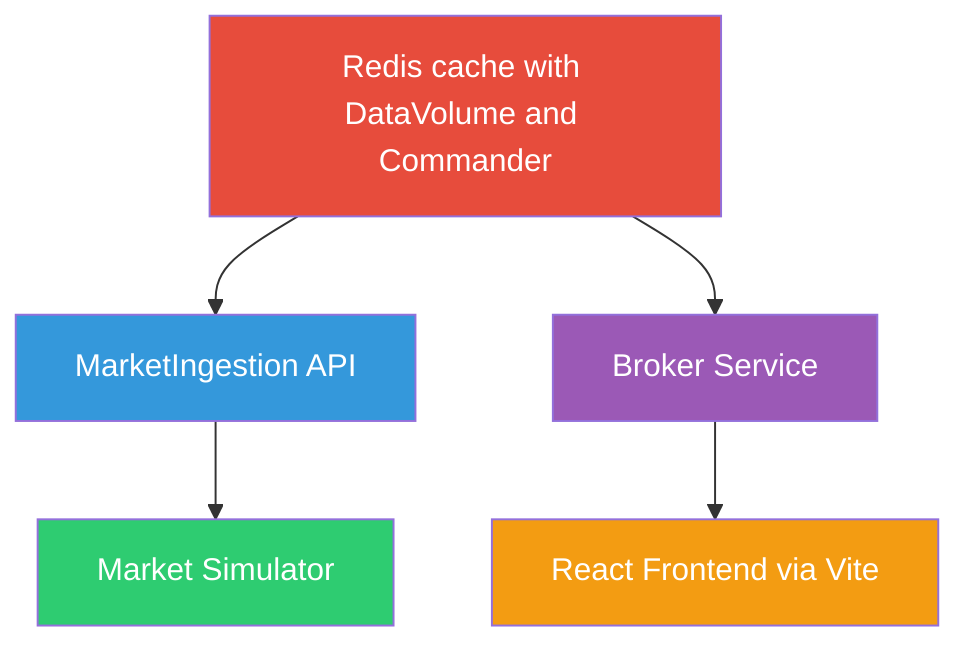

# Low-Level Design (LLD) — Stock Market Simulator

> **Version:** 1.0  
> **Last Updated:** 2026-02-07  
> **Audience:** Developers, contributors, technical leads

---

## Table of Contents

1. [Shared Contracts (Data Models)](#1-shared-contracts)
2. [Market Simulator Service](#2-market-simulator-service)
3. [Market Ingestion API](#3-market-ingestion-api)
4. [Broker Service](#4-broker-service)
5. [Frontend Application](#5-frontend-application)
6. [Aspire AppHost Orchestration](#6-aspire-apphost-orchestration)
7. [Error Handling and Resilience](#7-error-handling-and-resilience)
8. [Configuration Reference](#8-configuration-reference)

---

## 1. Shared Contracts

The `Shared.Contracts` project is a class library referenced by all backend services, providing a single source of truth for data shapes exchanged between components.



### Model Responsibilities

| Model | Where Produced | Where Consumed | Purpose |
|---|---|---|---|
| `MarketDataEvent` | MarketSimulator | Ingestion API, Broker Service, Frontend | Raw tick: symbol, price, volume, timestamp |
| `CandlestickEvent` | CandlestickAggregator (Broker) | Frontend | 1-minute OHLCV bar with open/close state |
| `Security` | RedisStreamConsumer (Broker) | Internal cache | Tracks latest and previous price for change calculation |
| `RedisStreamInfo` | RedisMonitoringController | Frontend Redis page | Stream health metrics |
| `ConsumerGroupInfo` | RedisMonitoringController | Frontend Redis page | Consumer group processing status |

### Key Design Notes

- `MarketDataEvent` and `CandlestickEvent` are **immutable records** (C# `record` types), preventing accidental mutation during transit.
- `Security` is a **mutable class** intentionally — it acts as an in-memory cache entry updated on every tick.
- `Change` and `ChangePercent` on `Security` are computed properties derived from `LastPrice` and `PreviousPrice`.

---

## 2. Market Simulator Service

### Purpose
A background worker that simulates a stock exchange by generating realistic price ticks at a configurable interval (default 300 ms) and forwarding them to the Ingestion API via HTTP.

### Architecture



### ExchangeSimulator — Execution Flow



### RealisticPriceEngine — Pricing Model

The engine generates statistically realistic prices using several financial mathematics techniques combined per tick:

**Step-by-step per tick:**

1. **Normal random shock** — A standard normal sample is generated via the Box-Muller transform.
2. **GARCH conditional volatility** — The current variance is computed from a persistence model: $\sigma^2_t = \omega + \alpha \cdot \epsilon^2_{t-1} + \beta \cdot \sigma^2_{t-1}$. This creates volatility clustering (volatile periods tend to cluster together).
3. **Ornstein-Uhlenbeck mean reversion** — A pull-back force toward the base price: $\text{pull} = -\kappa \cdot \frac{P_{t} - P_{\text{base}}}{P_{\text{base}}}$. Prevents prices from drifting to unrealistic extremes.
4. **Micro-trend drift** — Random directional trends lasting 40–200 ticks, creating recognizable chart patterns (uptrends, downtrends, consolidation).
5. **GBM multiplicative step** — All components are combined into a log-return and applied via $P_{t+1} = P_t \cdot e^{\text{logReturn}}$.
6. **Volume generation** — Base volume adjusted by ±50% random noise and amplified during high-volatility ticks.

**Symbol profiles** define per-symbol characteristics:

| Parameter | NIFTY50 | BANKNIFTY | RELIANCE | TCS |
|---|---|---|---|---|
| Base Price | 1000 | 1000 | 1000 | 1000 |
| Annual Volatility | 14% | 18% | 20% | 16% |
| Mean Reversion Strength | 0.0015 | 0.0012 | 0.0020 | 0.0018 |
| Base Volume | 6000 | 5500 | 8000 | 4500 |

### Retry Logic

HTTP calls to the Ingestion API use exponential backoff:
- **Max retries:** 3
- **Initial delay:** 100 ms, doubling each retry
- **Failure modes handled:** `HttpRequestException`, `TaskCanceledException` (timeout), generic exceptions
- **On max retries exceeded:** Log error and skip the tick (data loss is acceptable for simulation)

---

## 3. Market Ingestion API

### Purpose
An HTTP gateway that receives market data ticks, validates them, and appends them to a Redis Stream.

### Architecture



### Endpoint: `POST /api/marketdata`

**Input:** `MarketDataEvent` (JSON body)

**Validation rules:**
1. `Symbol` must not be empty or whitespace
2. `Price` must be greater than zero
3. `Volume` must be non-negative
4. `Timestamp` must not be more than 5 minutes in the future

**On success:**
- Serializes the event to JSON
- Calls `XADD marketdata:stream` on Redis with `MAXLEN ~10000` (approximate trimming keeps the most recent ~10,000 messages)
- Returns `200 OK` with the Redis stream message ID

**Error responses:**
- `422` — Validation failure with details
- `503` — Redis connection failure
- `504` — Redis timeout
- `500` — Unexpected error

### Redis Stream Structure

| Stream Key | Field | Value |
|---|---|---|
| `marketdata:stream` | `data` | JSON-serialized `MarketDataEvent` |

The stream uses approximate max length (`~10000`) for memory-efficient trimming without blocking Redis during cleanup.

---

## 4. Broker Service

### Purpose
The most complex service in the system. It consumes market data from Redis Streams, aggregates ticks into candlestick bars, and delivers both raw ticks and candle updates to browser clients via SSE.

### Internal Architecture



### RedisStreamConsumer — Message Consumption



**Consumer naming convention:** `{prefix}-{hostname}-{shortGuid}` (e.g., `broker-MacBook-a3f2c1d9`). This supports horizontal scaling where multiple broker instances share the consumer group.

**Error handling:**
- `RedisConnectionException` → retry after 5 seconds
- `RedisTimeoutException` → retry after 2 seconds
- Fatal error → retry after 10 seconds
- Invalid JSON → acknowledge message (prevent reprocessing), log error

### TickBroadcaster — Fan-Out Pattern

The broadcaster writes each tick to two bounded channels concurrently:

| Channel | Capacity | Reader | DropOldest? |
|---|---|---|---|
| SSE Tick Channel | 1000 | SseController, SseControllerV2, Minimal API | Yes |
| Aggregator Tick Channel | 2000 | CandlestickAggregator | Yes |

Uses `TryWrite` (non-blocking). If a channel is full, the oldest message is dropped and a warning is logged. This prevents the producer from being blocked by slow consumers.

### CandlestickAggregator — OHLCV Construction

```mermaid
stateDiagram_v2
    [*] --> WaitingForFirstTick
    WaitingForFirstTick --> AccumulatingTicks : First tick received
    AccumulatingTicks --> AccumulatingTicks : Same minute tick received
    AccumulatingTicks --> EmitCompletedCandle : Minute boundary crossed
    EmitCompletedCandle --> AccumulatingTicks : Start new candle with the crossing tick

    state AccumulatingTicks {
        [*] --> UpdateOHLCV
        UpdateOHLCV --> CheckThrottle
        CheckThrottle --> EmitInProgress : 500ms since last emit
        CheckThrottle --> SuppressEmit : Less than 500ms
    }
```

**Key behaviours:**
- Maintains one in-progress candle state per symbol (mutable `CandleState` object)
- **Throttled emission:** Only emits in-progress candle updates every 500 ms to avoid overwhelming the frontend
- **Completed candles:** Emitted immediately when a minute boundary is detected
- **Minute boundary timer:** A separate 1-second periodic timer checks for and closes stale candles even when no new ticks arrive
- Completed candles are stored in `CandlestickHistory` for replay on new SSE connections

### CandlestickHistory — Historical Seed and Storage

- **Ring buffer:** Per-symbol list capped at 60 candles (configurable)
- **Seed generation:** On first access, generates 30 historical candles using the same GBM + mean reversion model as the Market Simulator, providing immediate chart density for new connections
- **Deterministic seeding:** Uses `symbol.GetHashCode()` as the random seed, so historical data is consistent across restarts for the same symbol

### SSE Endpoints

| Endpoint | Controller | Features |
|---|---|---|
| `GET /api/marketdata/stream` | `SseController` | Primary endpoint. Multiplexes ticks + candles. Sends historical candles on connect. Heartbeat every 15s. |
| `GET /api/marketdata/stream-with-replay` | `SseControllerV2` | Supports `Last-Event-ID` header for missed event recovery using `MarketEventBuffer`. |
| `GET /api/marketdata/stream-minimal` | Minimal API (Program.cs) | Simplified demonstration endpoint using only ticks. |

### SSE Event Types

| Event Name | Data Shape | When Emitted |
|---|---|---|
| `connected` | `{ clientId, timestamp }` | Once on connection establishment |
| `marketdata` | `MarketDataEvent` | Every tick (~300 ms per symbol) |
| `candlestick` | `CandlestickEvent` | Historical candles on connect + throttled live updates + completed candles |
| `heartbeat` | `{ timestamp }` | Every 15 seconds to keep connection alive |

### SSE Connection Lifecycle



### MarketEventBuffer — Replay Support

- **Structure:** Linked list acting as a ring buffer (max 1000 events)
- **Event IDs:** Monotonically increasing counter (thread-safe via `Interlocked`)
- **Replay:** On reconnection, the `Last-Event-ID` header is parsed, and all events with higher IDs are replayed before live streaming resumes

### Redis Monitoring Controller

`GET /api/redis/streams/info` returns diagnostic information about the Redis stream:
- Message count
- First/last entry IDs and timestamps
- Consumer group details (name, consumer count, pending messages, last delivered ID)

Uses raw Redis `XINFO GROUPS` commands with manual result parsing.

---

## 5. Frontend Application

### Technology Stack

| Library | Version | Purpose |
|---|---|---|
| React | 19 | Component framework |
| TypeScript | 5.9 | Type safety |
| Material UI | 7 | Component library |
| D3.js | 7 | Candlestick chart rendering |
| React Router | 7 | Client-side routing |
| Vite | 7 | Build tool and dev server with API proxy |
| date-fns | 4 | Date formatting |

### Page Structure



### useMarketData Hook — Data Pipeline

The custom React hook manages the SSE connection lifecycle and distributes incoming events:

1. **Creates an `EventSource`** pointing at `/api/marketdata/stream`
2. **Listens for `marketdata` events** → updates a `Map<string, Security>` (watchlist and ticker strip)
3. **Listens for `candlestick` events** → passes to `PriceAggregator` → updates `Map<string, OHLC[]>` (chart data)
4. **Reconnection:** On error, retries up to 5 times with React state tracking
5. **Cleanup:** Closes `EventSource` on component unmount

### PriceAggregator Utility

Converts backend `CandlestickEvent` objects into the `OHLC[]` array format consumed by the D3 chart:

- **Completed candles** (`isComplete === true`): Inserted in sorted order, deduplicated by `intervalStart` timestamp
- **In-progress candles** (`isComplete === false`): Always placed as the last element, overwritten on each update
- **History cap:** Retains up to 60 candles (configurable)

### CandlestickChart Component

A custom D3.js-based candlestick chart with:

- **Candle bodies and wicks** (green for bullish, red for bearish)
- **Volume bars** below the price chart (height proportional to volume)
- **Current price line** (dashed, with value label on the right axis)
- **Crosshair interaction** with OHLCV tooltip on hover
- **Responsive layout** via `ResizeObserver` when `fullWidth` mode is active
- **TradingView-inspired dark colour scheme**

### Vite Proxy Configuration

In development, the Vite dev server proxies `/api/*` requests to the Broker Service, avoiding CORS issues:

| Env Variable | Purpose |
|---|---|
| `VITE_BROKER_URL` | Set by Aspire via `.WithEnvironment()` |
| `services__broker-service__http__0` | Set by Aspire via `.WithReference()` — service discovery |
| Fallback | `http://localhost:5046` |

---

## 6. Aspire AppHost Orchestration

### Resource Graph and Dependencies



**Startup order (enforced by `WaitFor()`):**
1. Redis starts and becomes healthy
2. Market Ingestion API starts and passes `/health` check
3. Market Simulator starts (depends on Ingestion API for sending data)
4. Broker Service starts (depends on Redis for consuming)
5. Web Frontend starts (depends on Broker Service for SSE)

**Service configuration injected by Aspire:**
- Redis connection string → Ingestion API and Broker Service (via `WithReference(cache)`)
- Ingestion API URL → Market Simulator (via `WithReference(ingestionApi)`)
- Broker Service URL → Frontend (via `WithEnvironment("VITE_BROKER_URL", ...)`)

---

## 7. Error Handling and Resilience

### Resilience Matrix

| Component | Failure Scenario | Handling Strategy |
|---|---|---|
| Market Simulator → Ingestion API | HTTP failure | Exponential backoff, max 3 retries, then skip tick |
| Market Simulator → Ingestion API | Timeout | Same as above (5-second client timeout) |
| Ingestion API → Redis | Connection lost | Returns 503 to caller |
| Ingestion API → Redis | Timeout | Returns 504 to caller |
| Broker → Redis | Connection lost | Retry after 5 seconds, indefinite loop |
| Broker → Redis | Timeout | Retry after 2 seconds |
| Broker channels | Channel full | DropOldest policy (non-blocking writes) |
| Browser → Broker (SSE) | Connection lost | EventSource auto-reconnect + Last-Event-ID replay (V2 endpoint) |
| Frontend | Max reconnection attempts | Display error message, prompt page refresh |

### Input Validation

Located at the Ingestion API boundary:
- Symbol: non-empty
- Price: positive decimal
- Volume: non-negative
- Timestamp: not more than 5 minutes in the future
- Invalid JSON in Redis stream: acknowledged to prevent reprocessing, error logged

---

## 8. Configuration Reference

### Market Simulator (`appsettings.json`)

| Key | Default | Description |
|---|---|---|
| `IngestionApiUrl` | `http://localhost:5001` | URL of the ingestion endpoint |
| `Symbols` | `["NIFTY50", "BANKNIFTY", "RELIANCE", "TCS"]` | Symbols to simulate |
| `TickIntervalMs` | `300` | Milliseconds between tick generations |
| `InitialPrice` | `1000` | Starting price for all symbols |

### Broker Service (`appsettings.json`)

| Key | Default | Description |
|---|---|---|
| `Cors:AllowedOrigins` | `["http://localhost:5000","http://localhost:5173"]` | Allowed CORS origins |
| `Redis:ConsumerNamePrefix` | `broker` | Prefix for consumer instance name |
| `Channel:Capacity` | `1000` | Bounded channel capacity for SSE ticks |
| `SSE:BufferSize` | `1000` | Ring buffer size for replay support |
| `Candlestick:IntervalSeconds` | `60` | Candlestick aggregation interval |
| `Candlestick:EmitThrottleMs` | `500` | Minimum interval between in-progress candle emissions |
| `Candlestick:MaxHistory` | `60` | Maximum completed candles retained per symbol |
| `Candlestick:SeedCount` | `30` | Number of synthetic historical candles generated on startup |
