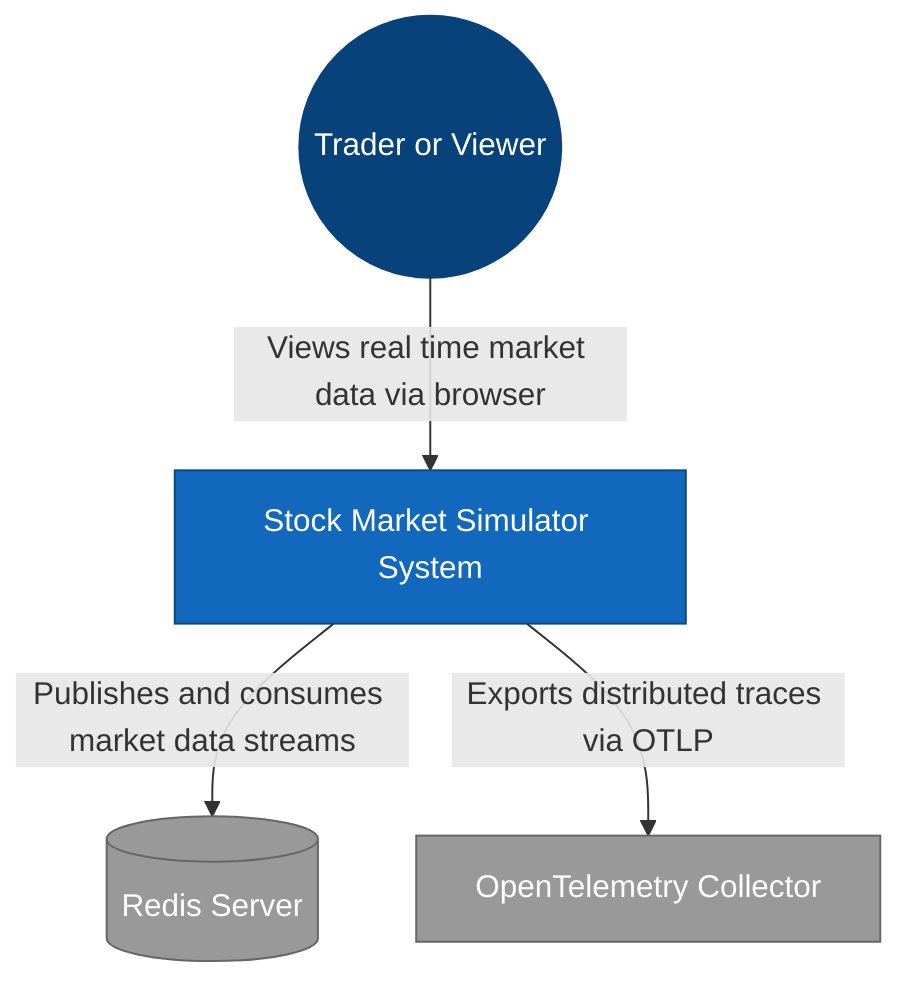
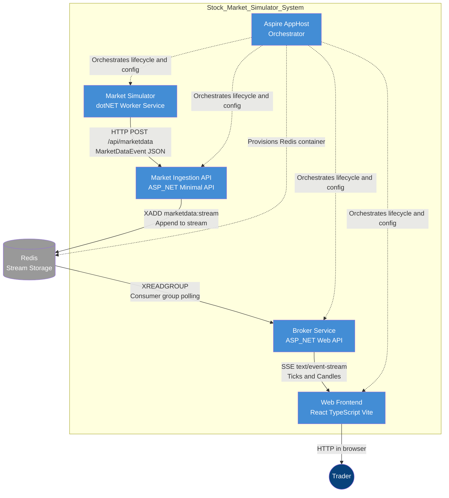
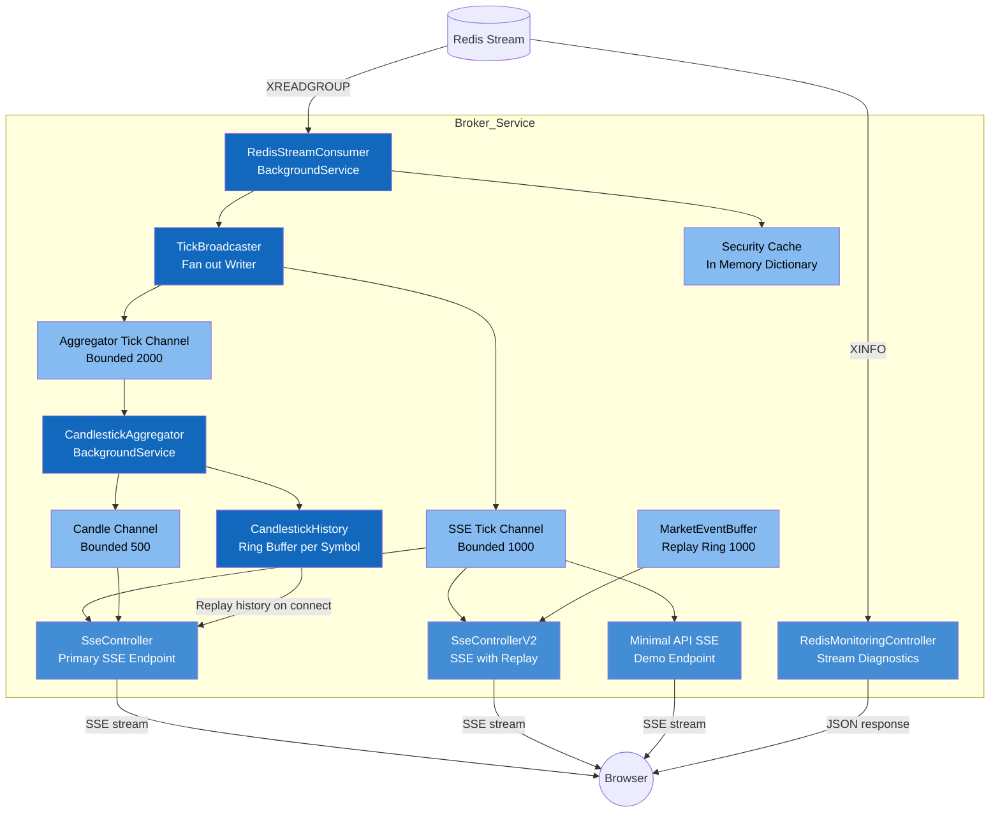
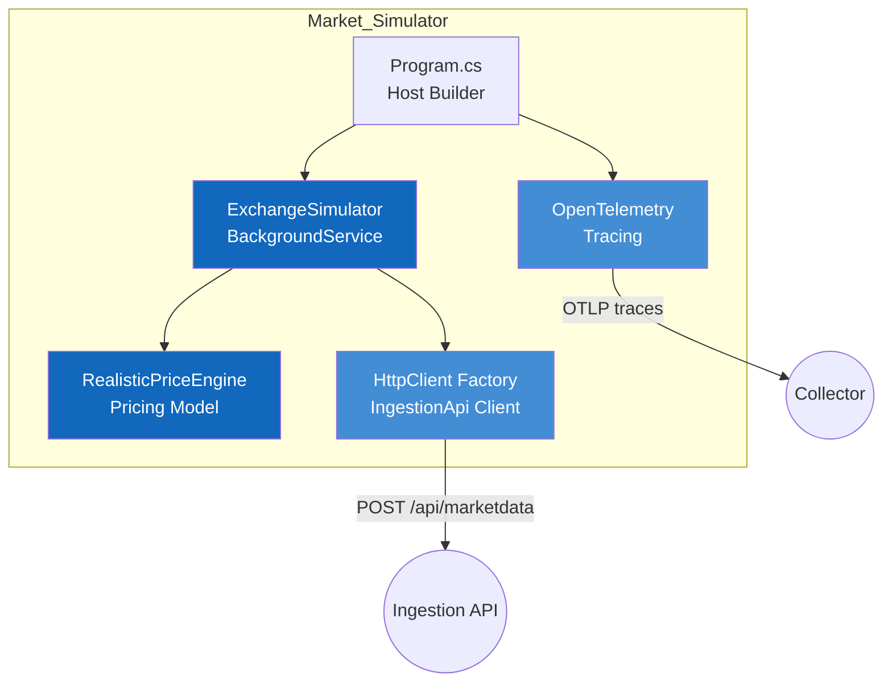
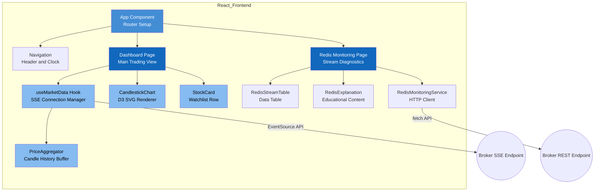
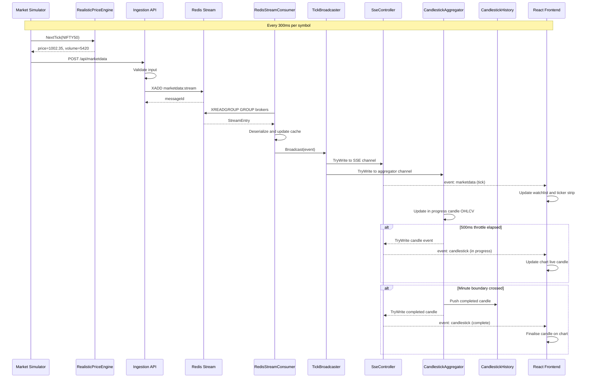
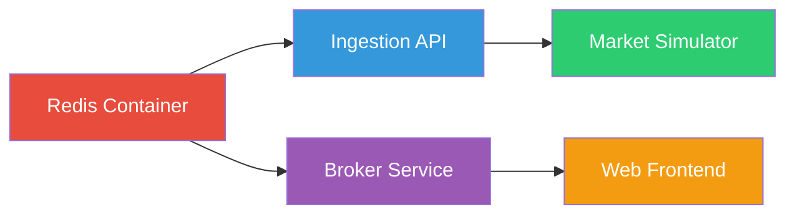
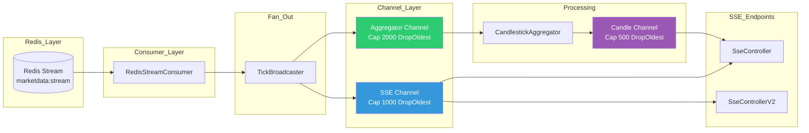

# C4 Architecture Diagrams — Stock Market Simulator

> **Format:** Mermaid.js  
> **Model:** C4 (Context, Container, Component, Code)  
> **Last Updated:** 2026-02-07

---

## Level 1: System Context Diagram

Shows the Stock Market Simulator system in its environment — who uses it and what external systems it interacts with.

**Key relationships:**
- A **Trader or Viewer** interacts with the system through a web browser to observe real-time stock prices and candlestick charts.
- The system uses **Redis** as its internal message broker (append-only stream).
- The system exports **OpenTelemetry** traces for observability and debugging.

---

## Level 2: Container Diagram

Zooms into the system to show the major deployable units (containers) and how they communicate.

**Container Descriptions:**

| Container | Technology | Responsibility |
|---|---|---|
| **Aspire AppHost** | .NET Aspire 13.1 | Orchestrates startup order, injects connection strings, manages health checks |
| **Market Simulator** | .NET 10 Worker Service | Generates realistic price ticks using GBM, Ornstein-Uhlenbeck, and GARCH models |
| **Market Ingestion API** | ASP.NET Core 10 Minimal API | Validates incoming market data and publishes to Redis Stream |
| **Broker Service** | ASP.NET Core 10 Web API | Consumes from Redis, aggregates candlesticks, streams via SSE |
| **Web Frontend** | React 19 + TypeScript 5.9 + D3.js 7 | Displays real-time dashboard with candlestick charts and watchlist |
| **Redis** | Redis 7+ (Docker) | Append-only stream storage with consumer group support |

---

## Level 3: Component Diagram — Broker Service

The Broker Service is the most complex container. This diagram shows its internal components.

**Component Descriptions:**

| Component | Type | Purpose |
|---|---|---|
| `RedisStreamConsumer` | `BackgroundService` | Polls Redis stream via consumer group, deserialises events, updates security cache, pushes to broadcaster |
| `TickBroadcaster` | Singleton | Fans out each tick to both the SSE channel and the aggregator channel via non-blocking writes |
| `CandlestickAggregator` | `BackgroundService` | Reads ticks from aggregator channel, builds 1-minute OHLCV candles, emits throttled updates |
| `CandlestickHistory` | Singleton | Ring buffer of completed candles per symbol; seeds historical candles on first access |
| `MarketEventBuffer` | Singleton | Ring buffer of SSE events (1000 max) supporting `Last-Event-ID` replay |
| `SseController` | API Controller | Primary SSE endpoint; multiplexes ticks + candles; sends history on connect; heartbeats |
| `SseControllerV2` | API Controller | SSE with `Last-Event-ID` replay support for reconnection resilience |
| `RedisMonitoringController` | API Controller | Exposes Redis stream and consumer group metrics |
| Security Cache | Dictionary | In-memory per-symbol price tracking (last price, previous price, volume) |

---

## Level 3: Component Diagram — Market Simulator

---

## Level 3: Component Diagram — Web Frontend

---

## Data Flow Diagram — End-to-End

---

## Dependency Graph — Service Startup Order

Arrows represent "must be ready before" relationships enforced by Aspire's `WaitFor()` method.

---

## Channel Pipeline Diagram

This diagram shows the bounded channel pipeline inside the Broker Service. Each channel has a fixed capacity and uses the DropOldest policy when full, ensuring the system never blocks or runs out of memory.
