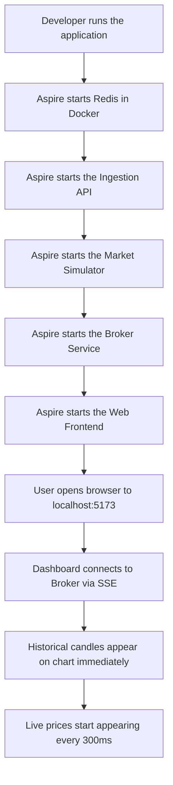
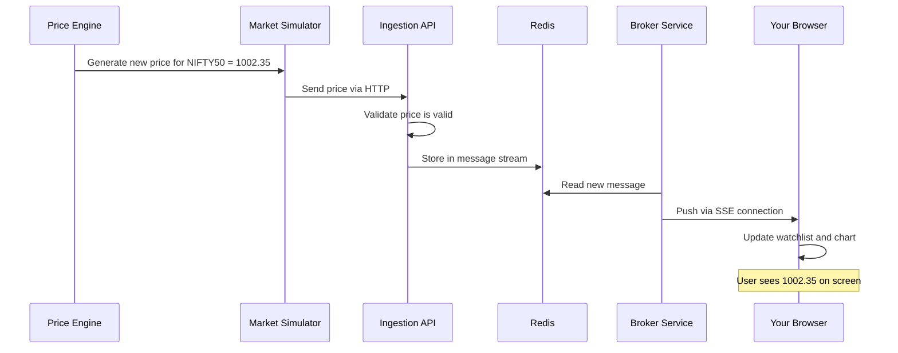
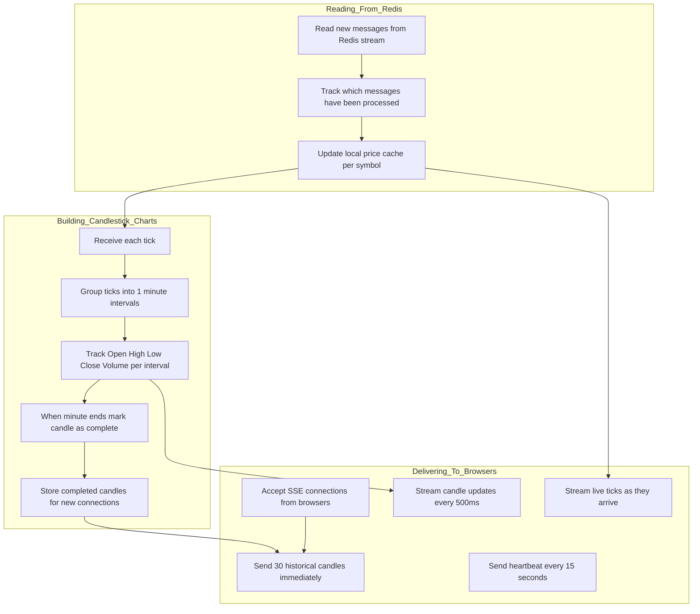
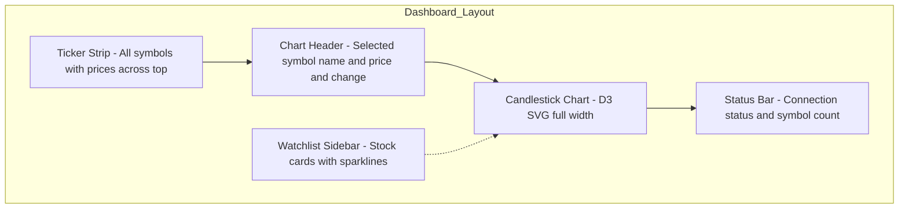

# Functional and Technical Documentation

> **Version:** 1.0  
> **Last Updated:** 2026-02-07  
> **Audience:** Non-technical stakeholders, QA engineers, business analysts, new contributors

---

## Table of Contents

1. [System Purpose and Overview](#1-system-purpose-and-overview)
2. [Functional Walkthrough](#2-functional-walkthrough)
3. [Service-by-Service Breakdown](#3-service-by-service-breakdown)
4. [Data Flow — From Price Generation to Screen](#4-data-flow-from-price-generation-to-screen)
5. [User Interface Features](#5-user-interface-features)
6. [Business Logic Details](#6-business-logic-details)
7. [API Reference](#7-api-reference)
8. [Configuration and Deployment](#8-configuration-and-deployment)
9. [Monitoring and Diagnostics](#9-monitoring-and-diagnostics)
10. [Frequently Asked Questions](#10-frequently-asked-questions)

---

## 1. System Purpose and Overview

### What does this system do?

The **Stock Market Simulator** mimics a real stock exchange. It creates realistic-looking stock prices for four Indian securities (NIFTY50, BANKNIFTY, RELIANCE, and TCS), streams them through a series of backend services, and displays them on a professional-looking web dashboard in real time.

### Who is it for?

- **Developers** learning about real-time data streaming, event-driven architecture, and financial data visualisation
- **Architects** evaluating technology patterns (Redis Streams, SSE, .NET Aspire)
- **Stakeholders** visualising how a market data pipeline works from end to end

### What technologies does it use?

| What | Technology | Why |
|---|---|---|
| Backend runtime | .NET 10 | Latest Microsoft application framework |
| Message broker | Redis Streams | Lightweight, fast, supports consumer groups for parallel processing |
| Real-time delivery | Server-Sent Events (SSE) | Pushes data from server to browser automatically |
| Frontend | React + TypeScript | Modern web framework with type safety |
| Charts | D3.js | Custom candlestick chart rendering |
| Orchestration | .NET Aspire | Manages all services, their startup order, and configuration |

---

## 2. Functional Walkthrough

### What happens when the system starts?



### What does the user see?

1. **Ticker strip** across the top — shows all four stock symbols with current price and percentage change, updating every fraction of a second
2. **Candlestick chart** in the centre — displays price history as green (up) and red (down) candlestick bars, with a new bar forming every minute
3. **Watchlist sidebar** on the right — shows each stock with its latest price, volume, change percentage, and a mini sparkline chart
4. **Status bar** at the bottom — shows connection status (LIVE/DISCONNECTED), the number of active symbols, and the technology stack

### How does a price update appear on screen?

This sequence describes the journey of a single price update from creation to display:



The entire journey takes less than half a second.

---

## 3. Service-by-Service Breakdown

### 3.1 Market Simulator — "The Price Generator"

**What it does:** Creates fake but realistic stock prices, simulating what a real stock exchange would produce.

**How it works (in simple terms):**

1. Every 300 milliseconds (roughly 3 times per second), it generates a new price for each of the 4 stock symbols
2. Prices are not purely random — they use mathematical models from quantitative finance that make the charts look like real stock charts:
   - Prices tend to **bounce around** a baseline value (they do not run away to infinity or zero)
   - **Volatile periods cluster together** — when prices swing wildly, the wildness tends to persist for a while before calming down
   - **Short-term trends** appear — the price may drift up for 15–30 seconds, then reverse, creating the patterns traders look for
3. Each generated price is sent to the Ingestion API via a standard HTTP call
4. If the HTTP call fails (e.g., API is temporarily unavailable), the simulator retries up to 3 times with increasing wait times before giving up on that specific price update

**Dependent services:** Market Ingestion API (receives the generated prices)

### 3.2 Market Ingestion API — "The Gatekeeper"

**What it does:** Receives price updates from the Market Simulator, checks they are valid, and stores them in the message stream.

**How it works:**

1. Exposes a single HTTP endpoint: `POST /api/marketdata`
2. When a price arrives, it validates the data:
   - The stock symbol must not be empty
   - The price must be a positive number
   - The volume must not be negative
   - The timestamp must not be too far in the future
3. Valid prices are stored in a **Redis Stream** — think of this as an append-only log where messages are added to the end and consumers read from where they left off
4. The stream automatically trims itself to keep only the most recent ~10,000 messages, preventing unlimited growth

**Dependent services:** Redis (for storage)

### 3.3 Broker Service — "The Dispatcher and Analyst"

**What it does:** This is the most complex service. It reads prices from Redis, builds chart data (candlestick bars), and delivers everything to web browsers in real time.

**How it works (major functions):**



**Key business logic — Candlestick Aggregation:**

A **candlestick** (also called a "candle bar") is a standard way to visualize stock price movement over time. Each candle represents one minute and shows:

| Field | Meaning |
|---|---|
| **Open** | The first price at the start of the minute |
| **High** | The highest price reached during the minute |
| **Low** | The lowest price reached during the minute |
| **Close** | The last price at the end of the minute |
| **Volume** | Total shares traded during the minute |

The system builds these candles from individual price ticks:
- When the first tick of a new minute arrives, a new candle is started
- As more ticks arrive within the same minute, the High, Low, Close, and Volume are updated
- When the next minute begins, the current candle is marked as "complete" and a new one starts
- Completed candles are stored in history (up to 60 per symbol)

**Key business logic — SSE Streaming:**

- When a browser connects, it receives the last 30 candles of historical data immediately so the chart is not empty
- Then it receives live updates: both raw ticks (for the watchlist) and candle updates (for the chart)
- If the browser loses connection and reconnects, it can resume from where it left off (using the V2 replay endpoint)
- A heartbeat ping is sent every 15 seconds to keep the connection alive

**Dependent services:** Redis (for reading messages), Web Frontend (consumes the SSE stream)

### 3.4 Web Frontend — "The Dashboard"

**What it does:** Presents a professional-looking trading dashboard in the browser.

**How it works:**

1. On page load, the React application establishes an SSE connection to the Broker Service
2. Historical candles arrive first and populate the chart immediately
3. As live ticks arrive, the watchlist (sidebar) updates with current prices, changes, and sparkline charts
4. As candle updates arrive, the candlestick chart updates in real time — the rightmost candle grows as the current minute progresses
5. The chart includes interactive features: crosshair on hover, OHLCV tooltip, volume bars below the price chart
6. A secondary page (Redis Monitoring) allows viewing the health of the Redis stream (message count, consumer groups, pending messages)

**Dependent services:** Broker Service (for market data via SSE and REST)

### 3.5 Aspire AppHost — "The Conductor"

**What it does:** Manages the lifecycle of all services, ensuring they start in the right order with the right configuration.

**How it works:**

1. Defines all resources: Redis, Ingestion API, Market Simulator, Broker Service, Frontend
2. Declares dependencies: "Ingestion API needs Redis", "Simulator needs Ingestion API", etc.
3. Waits for each dependency to be healthy before starting dependent services
4. Automatically injects connection strings and URLs so services can find each other

---

## 4. Data Flow — From Price Generation to Screen

### Step-by-step for a single NIFTY50 price tick

| Step | Component | What Happens | Data Shape |
|---|---|---|---|
| 1 | RealisticPriceEngine | Calculates next price using financial math models | price=1002.35, volume=5420 |
| 2 | ExchangeSimulator | Wraps the price in a `MarketDataEvent` object with symbol, price, volume, timestamp | `{Symbol: "NIFTY50", Price: 1002.35, Volume: 5420, Timestamp: "..."}` |
| 3 | HTTP Client | Sends the event as JSON to the Ingestion API | HTTP POST body |
| 4 | Ingestion API | Validates all fields are present and reasonable | Pass/Fail |
| 5 | Redis XADD | Appends the JSON to the `marketdata:stream` stream | Redis stream entry with auto-generated ID |
| 6 | RedisStreamConsumer | Reads the entry from the stream using consumer group | Deserialized `MarketDataEvent` |
| 7 | Security Cache | Updates the cached last/previous price for NIFTY50 | `Security` object |
| 8 | TickBroadcaster | Writes to SSE channel and Aggregator channel | Non-blocking write |
| 9a | SseController | Reads from SSE channel and writes to browser | `event: marketdata\ndata: {...}` |
| 9b | CandlestickAggregator | Updates current OHLCV values for the in-progress candle | `CandleState` updated |
| 10 | Browser (useMarketData) | Parses SSE event, updates React state | `Security` map updated |
| 11 | StockCard / Ticker | Re-renders with new price, flashes green/red | Visual update |
| 12 | CandlestickAggregator (500ms later) | Emits candle update via candle channel | `CandlestickEvent` |
| 13 | SseController | Reads candle event and writes to browser | `event: candlestick\ndata: {...}` |
| 14 | PriceAggregator | Updates the OHLC array for the chart | `OHLC[]` updated |
| 15 | CandlestickChart | D3 re-renders the SVG chart | Visual update |

---

## 5. User Interface Features

### Dashboard Page (/)



| UI Element | Description | Data Source |
|---|---|---|
| **Ticker Strip** | Horizontal scrollable bar showing all symbols with price and % change | `marketdata` SSE events |
| **Chart Header** | Shows selected symbol name, current price, absolute change, % change, volume | `marketdata` SSE events |
| **Candlestick Chart** | D3-rendered SVG showing OHLCV bars, volume bars, current price line, crosshair | `candlestick` SSE events + historical candles |
| **Status Bar** | Shows LIVE/DISCONNECTED indicator, "SSE Stream" label, symbol count, tech stack | Connection state from `useMarketData` hook |
| **Watchlist Sidebar** | List of StockCard rows with symbol, price, change%, sparkline, volume, last update | `marketdata` SSE events |

### Redis Monitoring Page (/redis-monitoring)

| UI Element | Description | Data Source |
|---|---|---|
| **Stream Table** | Shows stream name, message count, last message timestamp, consumer groups | `GET /api/redis/streams/info` |
| **Consumer Group Details** | Expandable rows showing group name, consumer count, pending messages | Same API endpoint |
| **Redis Explanation** | Educational accordion panels explaining Redis Streams concepts | Static content |
| **Refresh Button** | Manually refreshes stream data | Triggers new API call |

---

## 6. Business Logic Details

### Pricing Model — Why Prices Look Realistic

The system uses three mathematical models combined together to make prices look like real stock market data:

**1. Random Walk (Geometric Brownian Motion)**
- Each price change is a small random percentage up or down
- Percentage changes follow a bell curve (normal distribution)
- This is the same model used in the famous Black-Scholes options pricing formula

**2. Rubber Band Effect (Mean Reversion)**
- Prices are gently pulled back toward a base value (₹1000)
- If the price goes too high, the pull back down gets stronger
- If the price drops too low, the pull back up gets stronger
- This prevents prices from drifting to absurd values

**3. Volatility Clustering (GARCH)**
- When a large price move happens, subsequent moves tend to also be large
- Calm periods tend to follow calm periods
- This creates the "clusters of excitement" seen in real market charts

**4. Micro-Trends**
- Short directional movements lasting 12–60 seconds
- Price drifts slightly up or down during these periods
- Creates the uptrend/downtrend patterns that traders look for

### Change Calculation

For each stock, the system tracks:
- **Last Price:** The most recent price received
- **Previous Price:** The price just before the latest update
- **Change:** Last Price minus Previous Price (absolute change in ₹)
- **Change %:** (Change ÷ Previous Price) × 100

These drive the green (positive) / red (negative) colour coding throughout the UI.

### Data Retention

| Data | Where Stored | Retention |
|---|---|---|
| Raw price stream | Redis | Last ~10,000 messages (auto-trimmed) |
| Completed candles | Broker memory | Last 60 per symbol |
| SSE replay buffer | Broker memory | Last 1,000 events |
| Historical seed candles | Broker memory | 30 per symbol (generated on startup) |
| Frontend price state | Browser memory | Current session only |

---

## 7. API Reference

### Market Ingestion API (Port 5001)

| Method | Path | Description | Request Body | Response |
|---|---|---|---|---|
| POST | `/api/marketdata` | Submit a price tick | `MarketDataEvent` JSON | `200` with `{ messageId }` or error |
| GET | `/health` | Health check | — | `200 Healthy` or `503` |

### Broker Service (Port 5002)

| Method | Path | Description | Response Type |
|---|---|---|---|
| GET | `/api/marketdata/stream` | Primary SSE stream (ticks + candles + history) | `text/event-stream` |
| GET | `/api/marketdata/stream-with-replay` | SSE with Last-Event-ID replay support | `text/event-stream` |
| GET | `/api/marketdata/stream-minimal` | Simplified SSE (ticks only) | `text/event-stream` |
| GET | `/api/redis/streams/info` | Redis stream diagnostics | `application/json` |
| GET | `/health` | Health check | `200 Healthy` or `503` |

### SSE Event Format

Each SSE event follows this format:
```
id: <client>-<sequence>
event: <type>
data: <JSON>
```

**Event types:**
- `connected` — Sent once on connection, contains client ID
- `marketdata` — Raw price tick with symbol, price, volume, timestamp
- `candlestick` — OHLCV candle bar with open, high, low, close, volume, tick count, completion status
- `heartbeat` — Keep-alive ping sent every 15 seconds

---

## 8. Configuration and Deployment

### Prerequisites

| Requirement | Purpose |
|---|---|
| .NET 10.0.102+ SDK | Building and running backend services |
| Docker Desktop | Running the Redis container |
| Node.js 18+ | Running the Vite dev server for the frontend |

### Starting the System

```bash
# Start all services with Aspire
cd src/stock-market-simulator.AppHost
dotnet run
```

Aspire provisions Redis automatically. Ensure Docker Desktop is running.

**Optional: Manual start (advanced troubleshooting)**
```bash
# Terminal 1: Start Redis and Ingestion API
cd src/MarketIngestion.Api
dotnet run --urls "http://localhost:5001"

# Terminal 2: Start Broker Service
cd src/Broker.Service
dotnet run --urls "http://localhost:5002"

# Terminal 3: Start Market Simulator
cd src/MarketSimulator
dotnet run

# Terminal 4: Start Frontend
cd src/frontend
npm install && npm run dev
```

### Service Ports

| Service | Port | URL |
|---|---|---|
| Market Ingestion API | 5001 | http://localhost:5001 |
| Broker Service | 5002 | http://localhost:5002 |
| Web Frontend | 5173 | http://localhost:5173 |
| Redis | 6379 | localhost:6379 |

---

## 9. Monitoring and Diagnostics

### How to check if everything is working

| Check | How | Expected Result |
|---|---|---|
| Redis is running | Visit Redis Monitoring page in the UI | Stream shows non-zero message count |
| Ingestion API is healthy | `curl http://localhost:5001/health` | Returns `Healthy` |
| Broker Service is healthy | `curl http://localhost:5002/health` | Returns `Healthy` |
| SSE stream is flowing | Open browser dev tools → Network → filter EventStream | Events appearing every ~300ms |
| Prices are updating | Watch the dashboard | Prices flash green/red, chart updates |

### Troubleshooting

| Symptom | Likely Cause | Fix |
|---|---|---|
| Dashboard shows "Connecting..." | Broker Service not running | Start the Broker Service |
| Dashboard shows "DISCONNECTED" | SSE connection dropped | Check Broker logs, verify Redis is running |
| Chart is empty | No candle data yet | Wait 1 minute for the first candle to complete, or check that historical seeding is working |
| Prices not changing | Market Simulator not running | Start the Market Simulator |
| Redis Monitoring shows 0 messages | Ingestion API not receiving data | Check Market Simulator is posting to the correct URL |

---

## 10. Frequently Asked Questions

**Q: Are these real stock prices?**  
A: No. All prices are synthetically generated. They look realistic because they use the same mathematical models used in quantitative finance, but they have no connection to real markets.

**Q: Can I add more stock symbols?**  
A: Yes. Add the symbol name to the `Symbols` array in `MarketSimulator/appsettings.json`. If the symbol is not one of the four pre-configured ones (NIFTY50, BANKNIFTY, RELIANCE, TCS), sensible default parameters will be used.

**Q: How much data does the system store?**  
A: Redis keeps the last ~10,000 stream messages. The Broker keeps 60 completed candles per symbol in memory. The frontend keeps data only for the current browser session.

**Q: Can multiple browsers connect at the same time?**  
A: Yes. Each browser gets its own SSE connection with its own client ID. All clients receive the same data.

**Q: What happens if Redis goes down?**  
A: The Broker Service will keep retrying the Redis connection every few seconds. The Ingestion API will return 503 errors. The Market Simulator will skip ticks that fail to send. Once Redis recovers, normal operation resumes automatically.

**Q: Can I change the tick interval?**  
A: Yes. Change `TickIntervalMs` in `MarketSimulator/appsettings.json`. The default is 300ms (~3.3 ticks per second per symbol, or ~13 ticks/second total).

**Q: Can I change the candlestick interval from 1 minute?**  
A: Yes. Change `Candlestick:IntervalSeconds` in `Broker.Service/appsettings.json`. You could set it to 30 for 30-second candles, or 300 for 5-minute candles.
