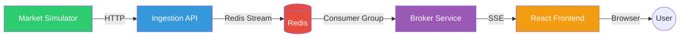

# Reference Documentation — Stock Market Simulator

> **Generated:** 2026-02-07  
> **Source:** Auto-generated from codebase analysis

---

## Documents

| # | Document | Audience | Description |
|---|---|---|---|
| 01 | [High-Level Design (HLD)](01-HIGH-LEVEL-DESIGN.md) | All stakeholders | System overview, architecture summary, component inventory, deployment topology, non-functional requirements, security considerations |
| 02 | [Low-Level Design (LLD)](02-LOW-LEVEL-DESIGN.md) | Developers, Tech Leads | Detailed design of every service: data models, class diagrams, execution flows, configuration reference, error handling matrix |
| 03 | [Architecture Decision Records (ADR)](03-ARCHITECTURE-DECISION-RECORDS.md) | Architects, Tech Leads | 10 key decisions with context, alternatives considered, and consequences (Redis Streams, SSE, Aspire, pricing models, backpressure, etc.) |
| 04 | [C4 Architecture Diagrams](04-C4-DIAGRAMS.md) | All stakeholders | Visual architecture at four levels: Context, Container, Component, and Code — all in Mermaid.js format |
| 05 | [Functional and Technical Documentation](05-FUNCTIONAL-TECHNICAL-DOCUMENTATION.md) | Non-technical stakeholders, QA, BA | Plain-English walkthrough of every service, data flow, UI features, business logic, API reference, troubleshooting, and FAQ |

---

## Quick Navigation by Role

### For Product Owners and Business Stakeholders
- Start with [Functional Documentation](05-FUNCTIONAL-TECHNICAL-DOCUMENTATION.md) — explains the system in plain English with no code
- Then review [HLD Section 1–2](01-HIGH-LEVEL-DESIGN.md) for the executive summary and business context

### For Solution Architects
- Start with [HLD](01-HIGH-LEVEL-DESIGN.md) for the architecture overview
- Review [C4 Diagrams](04-C4-DIAGRAMS.md) for visual architecture at all levels
- Study [ADRs](03-ARCHITECTURE-DECISION-RECORDS.md) for the rationale behind key decisions

### For Developers and Contributors
- Start with [LLD](02-LOW-LEVEL-DESIGN.md) for detailed service design, class diagrams, and configuration
- Reference [C4 Level 3 diagrams](04-C4-DIAGRAMS.md) for component-level architecture
- Check [ADRs](03-ARCHITECTURE-DECISION-RECORDS.md) before proposing changes to understand prior decisions

### For QA Engineers
- Start with [Functional Documentation](05-FUNCTIONAL-TECHNICAL-DOCUMENTATION.md) for feature descriptions and expected behaviours
- Use the [API Reference](05-FUNCTIONAL-TECHNICAL-DOCUMENTATION.md#7-api-reference) for endpoint testing
- Check the [Troubleshooting section](05-FUNCTIONAL-TECHNICAL-DOCUMENTATION.md#9-monitoring-and-diagnostics) for debugging

---

## Architecture Overview (Visual Summary)

---

## Diagram Index

All diagrams use **Mermaid.js** format and render in GitHub, VS Code, and most Markdown viewers.

| Diagram | Location | Type |
|---|---|---|
| System Context (C4 L1) | [C4 Diagrams](04-C4-DIAGRAMS.md#level-1-system-context-diagram) | Context |
| Container Diagram (C4 L2) | [C4 Diagrams](04-C4-DIAGRAMS.md#level-2-container-diagram) | Container |
| Broker Service Components (C4 L3) | [C4 Diagrams](04-C4-DIAGRAMS.md#level-3-component-diagram--broker-service) | Component |
| Market Simulator Components (C4 L3) | [C4 Diagrams](04-C4-DIAGRAMS.md#level-3-component-diagram--market-simulator) | Component |
| Frontend Components (C4 L3) | [C4 Diagrams](04-C4-DIAGRAMS.md#level-3-component-diagram--web-frontend) | Component |
| End-to-End Data Flow | [C4 Diagrams](04-C4-DIAGRAMS.md#data-flow-diagram--end-to-end) | Sequence |
| Service Startup Order | [C4 Diagrams](04-C4-DIAGRAMS.md#dependency-graph--service-startup-order) | Dependency |
| Channel Pipeline | [C4 Diagrams](04-C4-DIAGRAMS.md#channel-pipeline-diagram) | Flow |
| Data Model Class Diagram | [LLD](02-LOW-LEVEL-DESIGN.md#1-shared-contracts) | Class |
| ExchangeSimulator Flow | [LLD](02-LOW-LEVEL-DESIGN.md#exchangesimulator--execution-flow) | Sequence |
| Ingestion API Flow | [LLD](02-LOW-LEVEL-DESIGN.md#3-market-ingestion-api) | Flow |
| Redis Consumer Flow | [LLD](02-LOW-LEVEL-DESIGN.md#redisstreamconsumer--message-consumption) | Sequence |
| Candle Aggregation States | [LLD](02-LOW-LEVEL-DESIGN.md#candlestickaggregator--ohlcv-construction) | State |
| SSE Connection Lifecycle | [LLD](02-LOW-LEVEL-DESIGN.md#sse-connection-lifecycle) | Sequence |
| System Architecture Overview | [HLD](01-HIGH-LEVEL-DESIGN.md#3-system-architecture-overview) | Flow |
| Deployment Topology | [HLD](01-HIGH-LEVEL-DESIGN.md#7-deployment-topology) | Flow |
| Dashboard Layout | [Functional](05-FUNCTIONAL-TECHNICAL-DOCUMENTATION.md#5-user-interface-features) | Flow |
